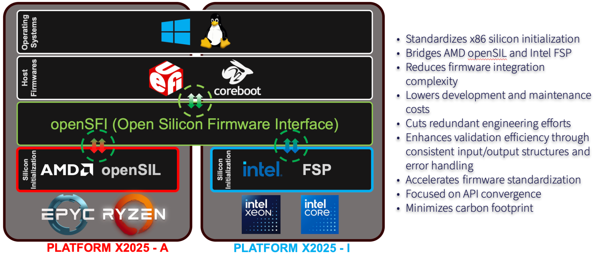

[← 6. Introduction](introduction.md) | [↑ Back to the specification](../open_silicon_firmware_interface_openSFI_specification.md#7-architecture-overview) | [8. API Definition →](api-definition.md)

# 7. Architecture Overview

openSFI adopts a Producer-Consumer API model for its external interface,
where openSFI acts as the producer and host firmware operates as the
consumer. Internally, the architecture leverages a factory design
pattern to provide a clean, consistent interface to silicon
initialization code. This factory pattern enables the creation of
appropriate initialization objects without exposing the concrete
implementation to the client code. By abstracting the creation process,
the system achieves a highly scalable interface between host firmware
and silicon components, allowing for flexible expansion when new silicon
variants are introduced without requiring modifications to the consumer
side. This architectural approach effectively decouples the host
firmware from the specifics of silicon initialization implementations,
promoting maintainability and adaptability as hardware evolves.

**Figure 6-1: openSFI Architectural Overview**

The openSFI interface provides:

- Standardized entry points for silicon initialization
  (InitializeSilicon()) and runtime operations
  (ExecuteSiliconRuntimeOp()), implemented by a vendor-supplied
  Library.

- StageID based lifecycle, with a universal, enumerated superset of
  discrete initialization stages.

- Explicit SoCID targeting to identify the silicon instance and
  vendor.

- Stage specific Input/Output structures, with optional metadata for
  cross-vendor compatibility.

- Host allocated output buffers, the openSFI Library only writes
  within the memory provided by the host.

- Stateless execution model, avoiding persistent Library state between
  calls.

---

[← 6. Introduction](introduction.md) | [↑ Back to the specification](../open_silicon_firmware_interface_openSFI_specification.md#7-architecture-overview) | [8. API Definition →](api-definition.md)
