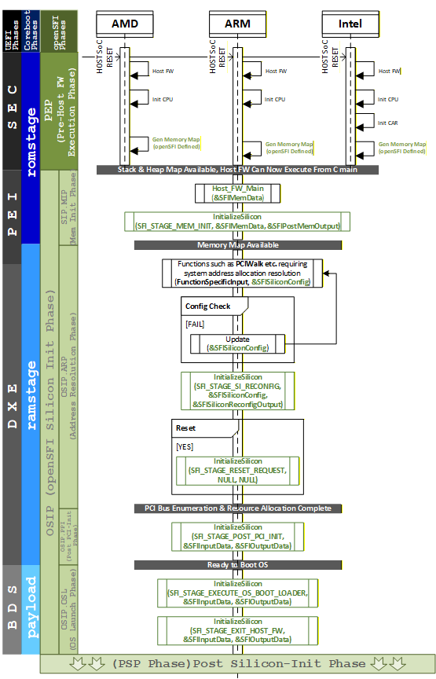

[← 8. API Definition](api-definition.md) | [↑ Back to the specification](../open_silicon_firmware_interface_openSFI_specification.md#9-opensfi-execution-model-and-boot-flow) | [10. Initialization Stages →](initialization-stages.md)

# 9. openSFI Execution Model and Boot Flow

Figure 9-1: openSFI initialization flow in silicon vendor firmware

This specification defines a structured model for platform
initialization by mapping existing execution flows into three distinct,
normalized phases.

*This specification defines interface boundaries and responsibilities
between host firmware and silicon firmware. It does not redefine or
mandate underlying platform execution flows.*

The three phases defined by this specification are:

- Pre-Host FW Execution Phase (hereafter, PEP)

- openSFI Silicon Initialization Phase ( hereafter, OSIP)

- Post Silicon-Init Phase (hereafter, PSP)

Each phase represents a well-defined portion of the boot process, with
explicit ownership, responsibilities, and transition points.

The accompanying sequence diagram ([Figure
9-1](#9-opensfi-execution-model-and-boot-flow)) illustrates this flow across multiple
architectures (AMD, ARM, Intel), aligned to common UEFI (SEC, PEI, DXE,
BDS) and coreboot (romstage, ramstage, payload) execution phases. The
following tables describe the diagram color convention.

| **Attribute** | **Green** | **Black** |
|:---|:---|:---|
| Text (name/label) | Defined by the openSFI specification | Defined by host firmware |
| Shape (procedure box) | Implemented by openSFI | Implemented by host firmware |

*Table 10-1: Color scheme for diagram attributes.*

| **Shape Color** | **Text Color** | **Meaning** |
|:---|:---|:---|
| **Green** | **Green** | Defined and implemented by openSFI |
| **Black** | **Green** | Defined by openSFI, implemented by host firmware |
| **Black** | **Black** | Defined and implemented by host firmware |
| **Green** | **Black** | Not used in this specification |

*Table 10-2: Color combination examples.*

## 9.1. Mapping to Existing Host Firmware Implementations

The phases defined in this specification represent a normalized
abstraction of platform initialization and do not introduce new
execution stages. Instead, they map to execution flows that already
exist within commonly deployed host firmware implementations.

In UEFI-based systems, execution begins in the SEC phase, followed by
PEI and DXE. In coreboot-based systems, execution begins in the
romstage, followed by the ramstage and subsequent payload execution
phases.

The PEP corresponds to early SEC or romstage behavior where
silicon-specific initialization is performed prior to openSFI defined
host firmware control.

The OSIP spans portions of execution that may overlap with PEI and early
DXE in UEFI implementations, or ramstage execution in coreboot. During
this phase, openSFI host firmware interacts with silicon firmware
through standard openSFI interfaces rather than embedding
silicon-specific logic.

The PSP phase corresponds to the portion of execution where platform
initialization is complete and control transitions to the operating
system.

Phase boundaries and sequencing may differ across implementations. This
specification defines the interface and responsibilities at transition
points, not the underlying execution flow

## 9.2. The PEP Phase

The PEP represents the portion of execution that occurs prior to any
invocation of openSFI APIs.

During this phase, silicon-specific firmware performs the minimal
initialization required to establish a functional execution environment.
This may include CPU initialization, early memory enablement, and
generation of an initial system memory map.

All behavior within the PEP is implementation-specific and outside the
scope of this specification. The above description is provided for
contextual understanding only. No openSFI execution exists in this
phase.

**Exit Requirements:**

- Permanent memory has been trained and fully initialized

- Sufficient memory shall be available for host firmware execution in
  a standard C or equivalent high-level language environment

- An initial system memory map shall be provided to the host firmware

The completion of the PEP represents the first well defined handoff
point, where control transitions from silicon firmware to host firmware.
At this point, host firmware is responsible for invoking openSFI
services to complete silicon initialization.

## 9.3. The OSIP Phase

The OSIP phase defines the interaction between host firmware and silicon
firmware through openSFI APIs. This phase is orchestrated entirely by
host firmware.

During OSIP phase, host firmware invokes the openSFI InitializeSilicon()
entrypoint API as a control and synchronization point during silicon
initialization. Progression through the OSIP phase is achieved by
invoking this API with Stage IDs corresponding to defined sub-phases.

The OSIP phase is divided into the following sub-phases:

- **System Resource Map Phase (hereafter, OSIP.SRM sub-phase)**

- **Address Resolution Phase (hereafter, OSIP.ARP sub-phase)**

- **Post PCI-Init Phase (hereafter, OSIP.PPI sub-phase)**

- **OS Launch Phase (hereafter, OSIP.OSL sub-phase)**

### 9.3.1. OSIP Execution Model

The following requirements define the execution model of OSIP phase:

- All OSIP phase functionality shall be invoked through the
  InitializeSilicon() API

- Host firmware shall control sequencing and progression across Stage
  IDs

- Host firmware shall maintain all state across API invocations

- Silicon firmware shall provide consistent behavior for a given Stage
  ID within a boot session

- Silicon firmware shall not assume persistence of data across
  invocations

**Stage ID Mapping**

| **OSIP sub-phase** | **Stage ID(s)** | **Normative Behavior** |
|:---|:---|:---|
| **OSIP.SRM** | SFI_STAGE_GET_SYS_RSC_MAP | Shall return system resource maps from early silicon initialization, including information related to memory, PCIe topology, CPU topology, etc. |
| **OSIP.ARP** | SFI_STAGE_SI_RECONFIG, SFI_STAGE_RESET_REQUEST | Shall support resource allocation, iterative refinement, and conditional reset |
| **OSIP.PPI** | SFI_STAGE_FINAL_SYS_RSC_MAP | Shall perform silicon configuration dependent on finalized resource assignments |
| **OSIP.OSL** | SFI_STAGE_PREPARE_FOR_OS_HANDOFF, SFI_STAGE_EXIT_HOST_FW | Shall prepare for OS execution and complete firmware exit sequence |

### 9.3.2. OSIP.SRM sub-phase

This sub-phase represents the first stage of the host-driven OSIP
phase.

In this sub-phase, host firmware invokes InitializeSilicon() with
SFI_STAGE_GET_SYS_RSC_MAP to obtain system resource maps from early
silicon initialization, including information related to memory, PCIe
topology, CPU topology, and other platform resources.

It is invoked with the following arguments:

| **Argument** | **Content** | **Value** |
|:---|:---|:---|
| SFIInput | &SFIMemData | The pointer to the Firmware Handoff Transfer List contains, at least, the data received from the vendor specific PEP phase via the data structure passed by the silicon firmware as an input to HostFWMain . The input Transfer List must contain: All Transfer Entries received from the PEP phase |
| SFIOutput | &SFIPostMemOutput | The pointer to the Firmware Handoff Transfer List which provides silicon-generated information required by host firmware to proceed with platform resource enumeration, including PCI discovery and allocation. The output Transfer List must contain: All Transfer Entries received in SFIMemData. The entries may have been modified by the host firmware. |
| InitStageID | SFI_STAGE_GET_SYS_RSC_MAP | Stage unique identifier |

This includes providing detailed system resource structures to enable
host firmware to proceed with platform resource allocation and
enumeration. The PCIe topology data must include details of the Root
Complex Topology existing on the SoC, as well as the PCI Express base
and limit settings for the Host Bridge(s). The CPU topology data must
encompass the CPUs in the system along with their corresponding APIC
IDs.

### 9.3.3. OSIP.ARP sub-phase

This sub-phase is responsible for platform resource discovery and
allocation.

In this sub-phase, host firmware performs operations such as PCI
enumeration and address assignment using data structures provided by
silicon firmware. Host firmware invokes InitializeSilicon()
with SFI_STAGE_SI_RECONFIG to iteratively refine system configuration.
It is invoked with the following arguments:

| **Argument** | **Content**               | **Value**               |
|:-------------|:--------------------------|:------------------------|
| SFIInput     | &SFISiliconConfig         | TBD                     |
| SFIOutput    | &SFISiliconReconfigOutput | TBD                     |
| InitStageID  | SFI_STAGE_SI_RECONFIG     | Stage unique identifier |

This sub-phase may require multiple iterations as conflicts are
detected and resolved. Host firmware adjusts input data structures and
re-invokes the API until a valid configuration is achieved.

If required, host firmware may invoke InitializeSilicon() with
SFI_STAGE_RESET_REQUEST, which may result in a platform reset. This
mechanism enables reinitialization under updated configuration
constraints. It is invoked with the following arguments:

| **Argument** | **Content**             | **Value**               |
|:-------------|:------------------------|:------------------------|
| InitStageID  | SFI_STAGE_RESET_REQUEST | Stage unique identifier |

OSIP.ARP is therefore a convergence phase that transitions the system
into a consistent and fully resolved configuration.

### 9.3.4. OSIP.PPI sub-phase

This sub-phase performs silicon configuration steps that depend on
finalized resource assignments.

Host firmware invokes InitializeSilicon() with
SFI_STAGE_FINAL_SYS_RSC_MAP to program silicon structures using
assigned addresses. This includes configuring hardware units, enabling
devices, and completing initialization steps dependent on the resolved
system address map. It is invoked with the following arguments:

| **Argument** | **Content**                 | **Value**               |
|:-------------|:----------------------------|:------------------------|
| SFIInput     | &SFIInputData               | TBD                     |
| SFIOutput    | &SFIOutputData              | TBD                     |
| InitStageID  | SFI_STAGE_FINAL_SYS_RSC_MAP | Stage unique identifier |

### 9.3.5. OSIP.OSL — OS Launch Phase

This sub-phase represents the final stage of the OSIP phase.

Host firmware invokes InitializeSilicon() with
SFI_STAGE_PREPARE_FOR_OS_HANDOFF to prepare the platform for operating
system execution. Final coordination ensures system readiness. It is
invoked with the following arguments:

| **Argument** | **Content**                      | **Value**               |
|:-------------|:---------------------------------|:------------------------|
| SFIInput     | &SFIInputData                    | TBD                     |
| SFIOutput    | &SFIOutputData                   | TBD                     |
| InitStageID  | SFI_STAGE_PREPARE_FOR_OS_HANDOFF | Stage unique identifier |

Host firmware then invokes InitializeSilicon() with
SFI_STAGE_EXIT_HOST_FW, signaling completion of firmware
responsibilities and transfer of control to the operating system
bootloader. It is invoked with the following arguments:

| **Argument** | **Content**            | **Value**               |
|:-------------|:-----------------------|:------------------------|
| SFIInput     | &SFIInputData          | TBD                     |
| SFIOutput    | &SFIOutputData         | TBD                     |
| InitStageID  | SFI_STAGE_EXIT_HOST_FW | Stage unique identifier |

## 9.4. The PSP Phase

The PSP phase represents execution after completion of the OSIP phase.

At entry to PSP phase:

- The platform shall be fully initialized

- Host firmware shall transfer control to the operating system

No further silicon configuration is expected.

Note: The PSP phase will be further enumerated in a subsequent revision
of the openSFI Specification.

## 9.5. Boot Flow Overview

1.  The boot process begins in the PEP, where silicon firmware
    initializes the platform to a state sufficient for host firmware
    execution, including establishing an execution environment and
    providing an initial memory map. Control is passed to host firmware
    via the host specific implementation of HostFWMain().

2.  Host firmware then enters the OSIP phase and begins invoking
    InitializeSilicon(). Within OSIP phase, execution progresses through
    the following sub-phases:

    1.  **[OSIP.SRM](#932-osipsrm-sub-phase):** Host firmware obtains system resource maps from early
        silicon initialization, including memory, PCIe topology, and CPU
        topology, producing complete resource maps for subsequent phases.

    2.  **[OSIP.ARP](#933-osiparp-sub-phase):** Host firmware performs resource discovery and
        allocation, including PCI enumeration and address assignment. This
        phase may iterate until a valid configuration is achieved, including
        optional reset cycles.

    3.  **[OSIP.PPI](#934-osipppi-sub-phase):** Silicon configuration dependent on finalized resource
        assignments is performed. Hardware structures are programmed using
        assigned addresses, and devices are enabled accordingly.

    4.  **[OSIP.OSL](#935-osiposl--os-launch-phase):** The platform is prepared for operating system
        execution. Final coordination between host firmware and silicon
        firmware ensures readiness for handoff, and host firmware
        transitions control toward the OS bootloader.

3.  Finally, host firmware transfers control to the operating system,
    entering the PSP.

Throughout this flow, host firmware owns sequencing, iteration, and
state management, while silicon firmware executes stage-specific
functionality in response to API invocations. The stateless nature of
the API ensures a clean separation of responsibilities.

## 9.6. Error Handling Semantics

The InitializeSilicon() API returns a status code indicating the result
of execution.

- Silicon firmware shall return a status that accurately reflects the
  outcome of the requested Stage ID

- Host firmware shall determine all subsequent actions based on the
  returned status

- This specification does not prescribe retry, fallback, or recovery
  behavior

If an unsupported configuration is detected:

- Silicon firmware shall return an unsupported status

- For the duration of the boot session, subsequent calls shall return
  consistent status

Stage-specific conditions:

- SFI_STAGE_SI_RECONFIG may be invoked multiple times to converge on a
  valid configuration

- SFI_STAGE_RESET_REQUEST may result in a platform reset

- After reset, execution shall resume according to platform-defined
  flow

---

[← 8. API Definition](api-definition.md) | [↑ Back to the specification](../open_silicon_firmware_interface_openSFI_specification.md#9-opensfi-execution-model-and-boot-flow) | [10. Initialization Stages →](initialization-stages.md)
