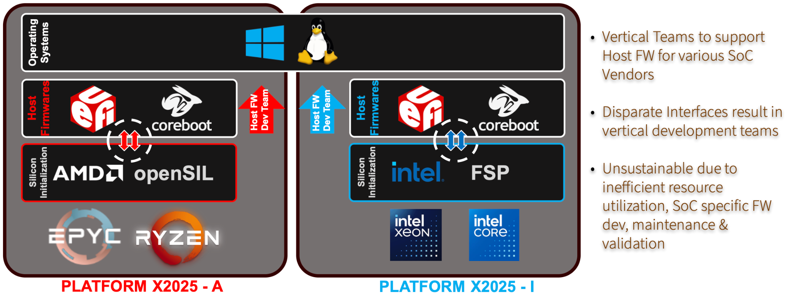
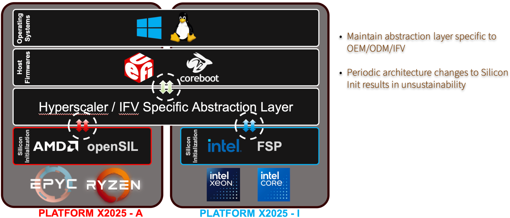

[← 3. Scope](scope.md) | [↑ Back to the specification](../open_silicon_firmware_interface_openSFI_specification.md#4-problem-statement) | [5. Introducing - openSFI →](introducing-opensfi.md)

# 4. Problem Statement

Modern day host firmware lacks a unified interface to interact with
silicon initialization code from different silicon vendors. As a result,
integrators are forced to implement and maintain vendor-specific boot
flows, leading to fragmented designs, duplicated engineering efforts,
and non-reusable codebases. Even when memory and I/O components are
identical across platforms, firmware teams must rework their integration
for each host SoC architecture. This results in extended development
timelines, increased support overhead, higher maintenance costs, and
inefficient resource utilization.

The design and maintenance of host firmware is increasingly
unsustainable as silicon diversity grows. Platform integrators must
support multiple silicon vendor SoCs, often within the same generation
of products, even when memory and I/O subsystems remain unchanged. This
diversity results in duplicated firmware stacks, fragmented debug
processes, and increased costs.

Every silicon vendor currently defines its own binary or API interface
for silicon initialization, leading to tight coupling between silicon
and host firmware. The lack of a unified abstraction layer forces
firmware teams to maintain separate branches for each SoC, reducing code
reuse and increasing development overhead.

Attempts to create internal abstraction layers by platform owners (or
IFVs) have shown to be fragile, requiring constant adaptation and
refactoring to changes in vendor specific silicon initialization
architecture. Furthermore, opaque silicon init flows hinder security
auditing, transparency, and validation.

Finally, redundant engineering and infrastructure overhead for
duplicated firmware validation contributes negatively to sustainability
goals. The absence of a common silicon initialization interface is a
critical gap in the ecosystem that openSFI aims to address.

---

[← 3. Scope](scope.md) | [↑ Back to the specification](../open_silicon_firmware_interface_openSFI_specification.md#4-problem-statement) | [5. Introducing - openSFI →](introducing-opensfi.md)
