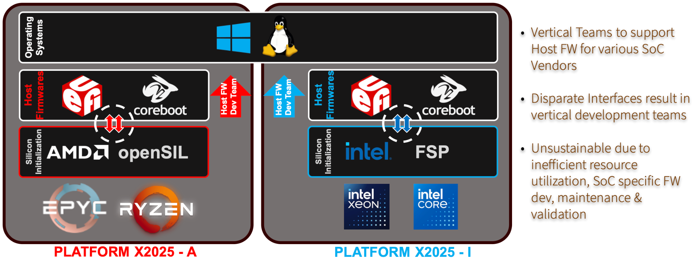
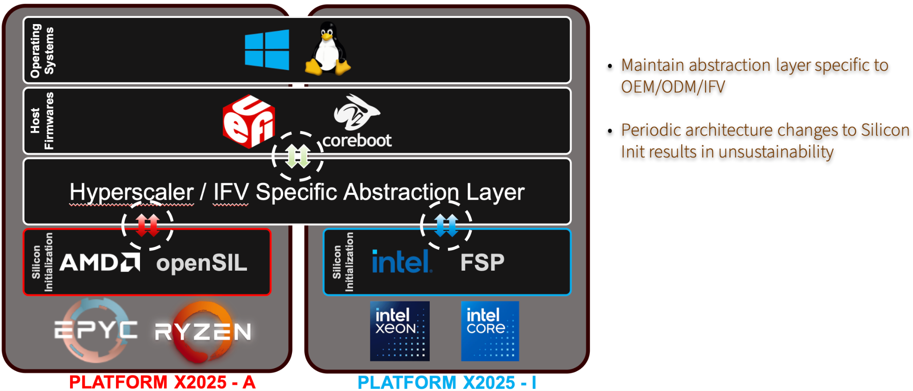
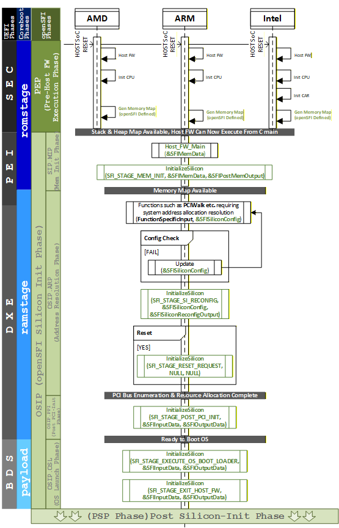

Open Platform Firmware

Open Silicon Firmware Interface (openSFI)

Firmware Architecture Specification (FAS)


Version 0.5

Authors:

Raj Kapoor (AMD), Albert Rennie (AMD), Srini Narayana (AMI), Tim Lewis
(Insyde)

Collaborators:

Allison Goodman (Intel), Michael Kinney (Intel), Felix Polyodov (AMI),
Giri Mudusuru (Microsoft), Dan Holmes-Mitra (Google), Paul Grimes
(AMD), Pradeep Gopal (AMD), Christian Walter (9 Elements), Senthil
Ramakrishnan (ARM), Jose Marinho (ARM), Jean-Marie Verdun (HPE), Nil
Ge (ByteDance), Hancock Chang (MiTAC), Piotr Król (3mdeb), Amos Bu
(OSFF), May Zhu (Dell Technologies)

# Version History

| **Date** | **Version \#** | **Author** | **Description** |
|----|----|----|----|
| 27 MAY ‘25 | 0.0.1 | Paul Grimes | Initial Release |
| 02 JUN ‘25 | 0.3 DRAFT | Albert Rennie<br>Raj Kapoor | \- Added Technical details throughout the document. Ready for OPF review.<br>- Added [Chapter 10 - Abstraction Layer](#appendix-e---abstraction-layer-defined-interface-spec)<br>- Added [Chapter 11 - Platform Configuration](#11-platform-input-configuration-semantics)<br>- Overhauled [Chapter 11 - Platform Input Configuration Semantics](#11-platform-input-configuration-semantics)<br>- Added [Appendix B - Clarifying Notes](#appendix-b---clarifying-notes)<br>- Added [Appendix C - Unified Enumerated Stages List](#appendix-c---unified-enumerated-stages-list)<br>- [License](#license) changed back to CC BY 4.0 per discussion in Mar 2025 F2F<br>- Added clarifying notes for SOCID & ExecuteSiliconRuntimeOp() at the bottom of [Section 8.2](#82-executepostsiliconinitop)<br>- Added Clarifying Notes for VAL in the [Terminology Section](#2-terminology) |
| 23 SEP’25 | 0.3 | Albert Rennie<br>Raj Kapoor | Voting Roster for OPF Ratification - COMPLETE<br>Ready for OCP Steering Committee WG Review<br>• This document will be frozen, and v0.5 DRAFT will be started based on this version.<br>• **OCP SC Approved - 09 SEP’25 (v0.3 FROZEN)**<br>• Link to [openSFI Firmware Architecture Specification v0.3](https://www.opencompute.org/documents/open-silicon-firmware-interface-opensfi-specification-v0-3-pdf) |
| 24 SEP’25 | 0.5<br>DRAFT | [Raj Kapoor](mailto:raj.kapoor@amd.com) | • Ready for v0.5 content<br>• All previous comments maintained<br>• Voting Roster reset<br>• Version changed to 0.5<br>• DRAFT watermark back on<br>• v0.3 Link added in the above row for v0.3<br>• Reverting RuntimeStageID to RuntimeOpsID<br>• Changed return var int to SFIInitStatus and SFIRuntimeStatus<br>• Deprecated host-provided SoC ID parameters and standardized hardware-derived SoC support enforcement via SFI_STATUS_UNSUPPORTED_SOC<br>• Changed scope to now include non x86 ISA.<br>• Updated Initialization Stages<br>• Added Silicon Initialization Flow<br>• Added Dell Technologies to the Voting Roster and the Collaborators list. |

# Table of Contents

- [Version History](#version-history)
- [License](#license)
- [Acknowledgements](#acknowledgements)
- [1. Compliance with OCP Tenets](#1-compliance-with-ocp-tenets)
  - [1.1. Openness](#11-openness)
  - [1.2. Efficiency](#12-efficiency)
  - [1.3. Impact](#13-impact)
  - [1.4. Sustainability](#14-sustainability)
- [2. Terminology](#2-terminology)
- [3. Scope](#3-scope)
- [4. Problem Statement](#4-problem-statement)
- [5. Introducing - openSFI](#5-introducing---opensfi)
  - [5.1. Description](#51-description)
  - [5.2. Scope](#52-scope)
  - [5.3. Goals](#53-goals)
  - [5.4. Naming Principles (Informative)](#54-naming-principles-informative)
  - [5.5. Interface Compatibility Testing](#55-interface-compatibility-testing)
  - [5.6. Standards Interoperability (Non-Normative) Compliance](#56-standards-interoperability-non-normative-compliance)
- [6. Architecture Overview](#6-architecture-overview)
- [7. SoC Support Determination and Enforcement](#7-soc-support-determination-and-enforcement)
  - [7.1. Hardware-Derived SoC Identification](#71-hardware-derived-soc-identification)
  - [7.2. Supported SoC Determination](#72-supported-soc-determination)
  - [7.3. Mandatory Error Signaling](#73-mandatory-error-signaling)
  - [7.4. Support Determination Invariance](#74-support-determination-invariance)
  - [7.5. Uniform Application Across APIs](#75-uniform-application-across-apis)
  - [7.6. Conformance Claim Integrity](#76-conformance-claim-integrity)
  - [7.7. Host Firmware Expectations (Non-Normative)](#77-host-firmware-expectations-non-normative)
- [8. API Definition](#8-api-definition)
  - [8.1. InitializeSilicon()](#81-initializesilicon)
  - [8.2. ExecutePostSiliconInitOp()](#82-executepostsiliconinitop)
  - [8.3. HostFWMain()](#83-hostfwmain)
  - [8.4. Library Model, State, and Ownership](#84-library-model-state-and-ownership)
    - [8.4.1. XFERLIST_SMBIOS_RECORD](#841-xferlist_smbios_record)
    - [8.4.2. XFERLIST_BOOT_MODE](#842-xferlist_boot_mode)
- [9. openSFI Execution Model and Boot Flow](#9-opensfi-execution-model-and-boot-flow)
  - [9.1. Mapping to Existing Host Firmware Implementations](#91-mapping-to-existing-host-firmware-implementations)
  - [9.2. The PEP Phase](#92-the-pep-phase)
  - [9.3. The OSIP Phase](#93-the-osip-phase)
    - [9.3.1. OSIP Execution Model](#931-osip-execution-model)
    - [9.3.2. OSIP.SRM sub-phase](#932-osipsrm-sub-phase)
    - [9.3.3. OSIP.ARP sub-phase](#933-osiparp-sub-phase)
    - [9.3.4. OSIP.PPI sub-phase](#934-osipppi-sub-phase)
    - [9.3.5. OSIP.OSL — OS Launch Phase](#935-osiposl--os-launch-phase)
  - [9.4. The PSP Phase](#94-the-psp-phase)
  - [9.5. Boot Flow Overview](#95-boot-flow-overview)
  - [9.6. Error Handling Semantics](#96-error-handling-semantics)
- [10. Initialization Stages](#10-initialization-stages)
  - [10.1. SFI_INIT_STAGE_LIB_INIT - Library Initialization Metadata Query Stage](#101-sfi_init_stage_lib_init---library-initialization-metadata-query-stage)
  - [10.2. Stage Execution Order Manifest (Normative)](#102-stage-execution-order-manifest-normative)
- [11. Platform Input Configuration Semantics](#11-platform-input-configuration-semantics)
  - [11.1. Purpose and Scope](#111-purpose-and-scope)
  - [11.2. Vendor Responsibility for Schema Definition](#112-vendor-responsibility-for-schema-definition)
  - [11.3. Format of Input and Output Structures](#113-format-of-input-and-output-structures)
  - [11.4. Relationship to UPCI](#114-relationship-to-upci)
  - [11.5. Error Handling for Memory Allocation](#115-error-handling-for-memory-allocation)
  - [11.6. Post DRAM Initialization Memory Availability](#116-post-dram-initialization-memory-availability)
- [12. Standards Alignment](#12-standards-alignment)
- [13. Governance](#13-governance)
- [Appendix A PascalCase Naming Convention (with Capitalized Acronyms)](#appendix-a-pascalcase-naming-convention-with-capitalized-acronyms)
  - [Naming Convention for Constants](#naming-convention-for-constants)
    - [Additional Tip:](#additional-tip)
  - [Naming Convention for Functions, Variables, and Parameters](#naming-convention-for-functions-variables-and-parameters)
- [Appendix B - Clarifying Notes](#appendix-b---clarifying-notes)
- [Appendix C - Unified Enumerated Stages List](#appendix-c---unified-enumerated-stages-list)
- [Appendix D - Supporting Documentation & Guidance](#appendix-d---supporting-documentation--guidance)
  - [openSFI FAS (openSFI Firmware Architecture Specification)](#opensfi-fas-opensfi-firmware-architecture-specification)
  - [openSFI SSImG (openSFI Silicon Specific Implementer’s Guide)](#opensfi-ssimg-opensfi-silicon-specific-implementers-guide)
  - [openSFI SSInG UEFI (openSFI SoC-Specific Integrator’s Guide for UEFI Host Firmware)](#opensfi-ssing-uefi-opensfi-soc-specific-integrators-guide-for-uefi-host-firmware)
  - [openSFI SSInG coreboot (openSFI SoC-Specific Integrator’s Guide for coreboot Host Firmware)](#opensfi-ssing-coreboot-opensfi-soc-specific-integrators-guide-for-coreboot-host-firmware)
- [Appendix E - Abstraction Layer (Defined Interface Spec)](#appendix-e---abstraction-layer-defined-interface-spec)
  - [Abstraction Layer (Defined Interface Spec)](#abstraction-layer-defined-interface-spec)
  - [Vendor Adaptation Layer (VAL / Shim Layer)](#vendor-adaptation-layer-val--shim-layer)
  - [Lifecycle of the VAL Library](#lifecycle-of-the-val-library)
  - [Design Goals and Benefits](#design-goals-and-benefits)
  - [Illustration – Conceptual Mapping](#illustration--conceptual-mapping)
- [Appendix F](#appendix-f)
- [Appendix G - Example Structures and Enumerations from Normative Specifications](#appendix-g---example-structures-and-enumerations-from-normative-specifications)
  - [G.1 SMBIOS Records](#g1-smbios-records)
    - [G.1.1 SMBIOS Record Header](#g11-smbios-record-header)
  - [Appendix G.2 Boot Modes](#appendix-g2-boot-modes)
  - [Appendix G.3 PCI Extended Configuration Access Mechanism (ECAM)](#appendix-g3-pci-extended-configuration-access-mechanism-ecam)
    - [G.3.1 XFERLIST_RESOURCE_DESCRIPTOR](#g31-xferlist_resource_descriptor)
- [Appendix H- Deprecating SoCID from the openSFI API](#appendix-h--deprecating-socid-from-the-opensfi-api)

# License

openSFI Firmware Architecture Specification is licensed under [**CC BY
4.0**](https://creativecommons.org/licenses/by/4.0/). To
view a copy of this license, visit
<https://creativecommons.org/licenses/by/4.0/>

**Creative Commons**

OCP encourages participants to share their proposals, specifications and
designs with the community. This is to promote openness and encourage
continuous and open feedback. It is important to remember that by
providing feedback for any such documents, whether in written or verbal
form, that the contributor or the contributor's organization grants OCP
and its members irrevocable right to use this feedback for any purpose
without any further obligation.

It is acknowledged that any such documentation and any ancillary
materials that are provided to OCP in connection with this document,
including without limitation any white papers, articles, photographs,
studies, diagrams, contact information (together, “Materials”) are made
available under the Creative Commons Attribution 4.0 International
License found here:
<https://creativecommons.org/licenses/by/4.0/>,
or any later version, and without limiting the foregoing, OCP may make
the Materials available under such terms.

As a contributor to this document, all members represent that they have
the authority to grant the rights and licenses herein. They further
represent and warrant that the Materials do not and will not violate the
copyrights or misappropriate the trade secret rights of any third party,
including without limitation rights in intellectual property. The
contributor(s) also represent that, to the extent the Materials include
materials protected by copyright or trade secret rights that are owned
or created by any third-party, they have obtained permission for its use
consistent with the foregoing. They will provide OCP evidence of such
permission upon OCP’s request. This document and any "Materials" are
published on the respective project's wiki page and are open to the
public in accordance with OCP's Bylaws and IP Policy. This can be found
at
<http://www.opencompute.org/participate/legal-documents/>
. If you have any questions, please contact OCP.

# Acknowledgements

The Authors of this Specification would like to acknowledge the
following for their feedback:

3mdeb, 9elements, AMD, AMI, ByteDance, Google, Hewlett Packard
Enterprise (HPE), Intel,

Insyde, Microsoft, MiTAC

# 1. Compliance with OCP Tenets

## 1.1. Openness

Promotes openness and efficiency by enabling third parties to build,
modify, and personalize a unified firmware interface that is compatible
across multiple platforms and silicon architectures.

## 1.2. Efficiency

Reduce operational expenses, capital expenses and carbon emissions
through a unified firmware interface. This enables efficient resource
utilization, streamlines development processes, and eliminates redundant
engineering efforts.

## 1.3. Impact

Has transformative impacts on the industry by accelerating
time-to-market with standardized interfaces.

## 1.4. Sustainability

Enables optimization of code to reduce resource consumption.

# 2. Terminology

- **openSFI**: **O**pen-Source **S**ilicon **F**irmware **I**nterface.
  An unified interface between the Host Firmware and the Silicon
  Initialization firmware

- **UPCI**: **U**nified **P**latform **C**onfiguration **I**nterface.
  A spec to define various interpretable binary formats between data
  producers and consumers.

- **VAL**: **V**endor **A**daptation **L**ayer Library - An
  implementation of this openSFI Specification.

> Note: The VAL chapter has been relocated to the [Appendix
> E](#appendix-e---abstraction-layer-defined-interface-spec)
> in v0.3 of this specification. This is a transitional measure,
> intended to provide reference context while the community calibrates
> to the scope and boundaries of the main openSFI specification. The VAL
> content is currently non-normative, and the long-term plan is to
> gradually externalize this content, potentially into a separate
> standalone document by v0.8. All references to VAL within this
> specification will be reviewed and updated accordingly in future
> revisions.

- **Host Firmware**: Bootloader Firmware executing on a platform host
  processor (aka application processor) such as x86 CPUs based on AMD
  & Intel, or other ISAs such as an ARM SoC. Examples include coreboot
  (Dasharo and Libreboot etc.) and UEFI (EDK2, Aptio, H2O, etc). In
  the context of openSFI, this includes all bootloader firmware
  excluding SiP specific firmware and openSFI.

- **SoC**: System on a Chip, including the CPU (Central Processing
  Unit).

- **API**: **A**pplication **P**rogramming **I**nterface.

- **SiP**: **Si**licon **P**rovider, aka Silicon Vendor

- **Factory Design Pattern**: A creational design pattern that
  provides an interface for creating objects in a superclass, but
  allows subclasses to alter the type of objects that will be created
  (Reference -
  <https://refactoring.guru/design-patterns/factory-method>)

- **Firmware Handoff Transfer List** - Extensible data structure
  consisting of a fixed-length header and a list of self-describing
  Transfer Entries. See
  <https://firmwarehandoff.github.io/firmware_handoff/main/transfer_list.html>

- **Firmware Handoff Transfer Entries (or “Transfer Entries”)** -
  Variable length self-describing data structure consisting of a
  fixed-length header and the body. The format of the body is
  determined by the tag_id field in the header. See
  <https://firmwarehandoff.github.io/firmware_handoff/main/transfer_list.html#tl-entry-header>

# 3. Scope

The specification addresses the lack of common firmware interfaces
across silicon vendors and platform firmware for host platform
initialization, leading to fragmented host firmware and increased costs.

The openSFI specification defines a unified interface between host
firmware and silicon initialization components. It targets x86 SoCs (AMD
and Intel) in its initial release but is designed to be ISA-neutral and
extensible.

The openSFI interface definition considers the bootflow from reset
through OS handoff and runtime services. The interface definition may be
phased in its approach and release to only define common firmware
interfaces for sections of the boot. (for example, from memory
initialization through bootloader exit)

The scope includes:

- API definition for calling silicon initialization routine

- Runtime or post-boot API services

- Platform configuration integration (UPCI) if required

- Support for bootloader integration (UEFI, coreboot, etc.)

Out of Scope:

- Merging of vendor-specific silicon firmware implementations

# 4. Problem Statement

Modern day host firmware lacks a unified interface to interact with
silicon initialization code from different silicon vendors. As a result,
integrators are forced to implement and maintain vendor-specific boot
flows, leading to fragmented designs, duplicated engineering efforts,
and non-reusable codebases. Even when memory and I/O components are
identical across platforms, firmware teams must rework their integration
for each host SoC architecture. This results in extended development
timelines, increased support overhead, higher maintenance costs, and
inefficient resource utilization.



The design and maintenance of host firmware is increasingly
unsustainable as silicon diversity grows. Platform integrators must
support multiple silicon vendor SoCs, often within the same generation
of products, even when memory and I/O subsystems remain unchanged. This
diversity results in duplicated firmware stacks, fragmented debug
processes, and increased costs.

Every silicon vendor currently defines its own binary or API interface
for silicon initialization, leading to tight coupling between silicon
and host firmware. The lack of a unified abstraction layer forces
firmware teams to maintain separate branches for each SoC, reducing code
reuse and increasing development overhead.

Attempts to create internal abstraction layers by platform owners (or
IFVs) have shown to be fragile, requiring constant adaptation and
refactoring to changes in vendor specific silicon initialization
architecture. Furthermore, opaque silicon init flows hinder security
auditing, transparency, and validation.



Finally, redundant engineering and infrastructure overhead for
duplicated firmware validation contributes negatively to sustainability
goals. The absence of a common silicon initialization interface is a
critical gap in the ecosystem that openSFI aims to address.

# 5. Introducing - openSFI

The Open Silicon Firmware Interface (openSFI) is a specification that
defines a common, architecture-neutral interface for host firmware to
interact with silicon initialization firmware. Its goal is to enable
modular, scalable, and vendor-agnostic integration of silicon into host
firmware environments.

**openSFI Specification is the Foundational Contract**. Host firmware
should not care how the silicon initialization is implemented. It just
needs a clean, stable API contract to call the right function, with the
right inputs, and get deterministic outputs.

## 5.1. Description

openSFI aims to address the fragmentation and fragility in firmware
systems by defining a common silicon firmware interface. This design
specification focuses on creating a scalable and flexible framework
that enhances interoperability across various silicon platforms. Key
features include:

- **Unified Interface Definition:** openSFI will standardize
  interactions between host firmware and silicon vendors, simplifying
  integration and interaction.

- **Platform Integration:** Streamlined methods to integrate diverse
  silicon, aligning with Open Compute Project (OCP) principles.

- **Resource Efficiency:** Promoting sustainability by optimizing
  firmware processes and reducing redundant engineering work across
  multi-generational platforms.

- **Industry Collaboration:** Encourages collaboration among industry
  participants to bridge ecosystem gaps while maintaining backward
  compatibility.

## 5.2. Scope

openSFI defines a standard interface between host firmware and silicon
lifecycle management components, supporting both initialization and
post-boot operations.

The openSFI specification defines a C-based interface between host
firmware and silicon initialization components (e.g., AMD openSIL,
Intel FSP, ARM Trusted FW). It is targeted to be ISA-neutral. openSFI
standardizes early boot silicon initialization during the SEC, PEI,
and early DXE phases (in UEFI terminology), or equivalent early stages
in other firmware frameworks like coreboot.

## 5.3. Goals

The primary goals of the openSFI are to:

- **Unify** silicon initialization interfaces across vendors.

- **Simplify** host firmware integration.

- **Enable** reuse of host firmware across platforms and vendors.

- **Reduce** engineering cost, duplication, and validation overhead.

- **Promote** sustainability through efficient resource usage and
  common tooling.

## 5.4. Naming Principles (Informative)

This specification defines phase and stage terminology based on
functional responsibilities rather than relative positioning within a
platform’s execution timeline.

To ensure consistency and portability across architectures and host
firmware implementations, the following principles are applied:

- ***Function-Based Naming***

  Phases and stages are named according to the responsibilities they
  represent (for example, initialization, resource allocation, or OS
  handoff), rather than when they occur in a given implementation.

- ***Avoidance of Relative Terms***

  Relative terms such as “early,” “mid,” or “late” are avoided where
  possible, as they are inherently dependent on
  implementation-specific timelines and may vary across architectures
  and firmware frameworks.

- ***Architecture Agnostic Terminology***

  Terminology is selected to remain consistent across different
  silicon providers and host firmware implementations, without
  implying a specific execution model.

- ***Stability Across Implementations***

  Names are chosen to remain stable even as underlying silicon
  architectures and firmware implementations evolve over time.

These principles enable the specification to provide a normalized and
portable abstraction of platform initialization, independent of the
underlying execution flow.

## 5.5. Interface Compatibility Testing

Interface compatibility testing for openSFI ensures predictable
interoperability across diverse silicon platforms while maintaining
adherence to established interface definitions.

- **Compatibility Procedures:**

  - Validate API implementation against defined specification,
    data-types and encoding format of input and output parameters,
    and return values.

  - Define and execute test cases that confirm cross-platform
    interoperability, leveraging existing platforms or a
    vendor-neutral simulated reference implementation to validate
    integration behavior and performance. This enables consistent
    benchmarking, helps detect regressions, and ensures that
    openSFI-compliant integrations meet the intended abstraction
    guarantees.

  - Execute test cases to ensure no output buffer overflows occur
    across API calls, alignment requirements are met and APIs can
    handle malformed or incorrect input parameters and return
    appropriate error codes.

- **Success Criteria:**

  - Implementation conforms to API contract in terms of data-types
    of input and output parameters, required encoding formats are
    strictly met(such as UPCI specified encoding), and return values
    are compliant with the specification.

  - Host firmware can successfully interface with silicon from
    multiple vendors without requiring vendor-specific changes in
    the host firmware.

  - Any non-functional requirements are met like execution
    performance(E.g.: time-bounded return of API calls) and
    robustness of implementation ensuring no unwanted side effects
    such as data corruption occurs.

## 5.6. Standards Interoperability (Non-Normative) Compliance

openSFI does not establish or replace external industry standards
(e.g., ACPI, SMBIOS, UEFI). However, implementations must not preclude
standard host firmware behavior or break assumptions made by standards
compliant firmware frameworks and operating systems.

In practice, this means:

- **Interoperable Outputs:** Data produced via openSFI (e.g. hardware
  description, discovery, or telemetry) MUST be emitted in a form that
  host firmware can reliably translate into standards compliant
  artifacts without ambiguity or loss of fidelity.

- **No Contract Violations:** openSFI MUST NOT introduce ordering,
  timing, or data dependencies that conflict with normative behavior
  required by ACPI/UEFI/SMBIOS (or other applicable standards) in the
  platform’s boot flow.

- **Forward Compatibility:** Where a vendor returns “fragments” or
  partial descriptors, those fragments MUST be “standard-ready”, i.e.
  structurally sufficient and unambiguous so the host can
  deterministically assemble fully compliant tables/records.

Here's a succinct example (ACPI): A VAL may return ACPI ready
fragments (e.g. CPU topology, memory map deltas, device resources)
that are not complete ACPI tables by themselves. These fragments MUST
be formatted and annotated such that the host firmware can compose
fully compliant ACPI structures (e.g. MADT, SRAT, SLIT, HEST) without
guessing or vendor specific heuristics. Failure to meet this
requirement risks breaking OS expectations and is non-conformant with
openSFI’s interoperability rules.

# 6. Architecture Overview

openSFI adopts a Producer-Consumer API model for its external interface,
where openSFI acts as the producer and host firmware operates as the
consumer. Internally, the architecture leverages a factory design
pattern to provide a clean, consistent interface to silicon
initialization code. This factory pattern enables the creation of
appropriate initialization objects without exposing the concrete
implementation to the client code. By abstracting the creation process,
the system achieves a highly scalable interface between host firmware
and silicon components, allowing for flexible expansion when new silicon
variants are introduced without requiring modifications to the consumer
side. This architectural approach effectively decouples the host
firmware from the specifics of silicon initialization implementations,
promoting maintainability and adaptability as hardware evolves.

**Figure 6-1: openSFI Architectural Overview**


The openSFI interface provides:

- Standardized entry points for silicon initialization
  (InitializeSilicon()) and runtime operations
  (ExecutePostSiliconInitOp()), implemented by a vendor-supplied
  Library.

- StageID based lifecycle, with a universal, enumerated superset of
  discrete initialization stages.

- Stage specific Input/Output structures, with optional metadata for
  cross-vendor compatibility.

- Host allocated output buffers, the openSFI Library only writes
  within the memory provided by the host.

- Stateless execution model, avoiding persistent Library state between
  calls.

# 7. SoC Support Determination and Enforcement

The following requirements are mandatory for any silicon firmware
implementation claiming compliance with the current revision of the
specification.

## 7.1. Hardware-Derived SoC Identification

- The silicon firmware **MUST** derive the executing SoC identity exclusively from hardware-resident identification mechanisms.

   *Meaning: SoC identity must come from on-silicon sources such as ID registers, fuses, or architecturally defined identification instructions.*

- The silicon firmware **MUST NOT** rely on host-provided parameters, configuration data, or API arguments to determine SoC identity.

   *Meaning: Host firmware cannot assert, override, or influence the identity of the executing silicon.*

## 7.2. Supported SoC Determination

- The silicon firmware MUST determine whether the executing SoC is within its supported set before performing any functional work for an openSFI API invocation.

   *Meaning: Support must be checked up-front, not after partial initialization or runtime activity.*

- The supported set MUST include all constraints required for correct operation, including SoC family, revision or stepping, and required feature or SKU characteristics.

   *Meaning: “Supported” is not limited to a marketing name, but includes all hardware*

## 7.3. Mandatory Error Signaling

- If the executing SoC is not supported, the silicon firmware **MUST** return SFI_STATUS_UNSUPPORTED_SOC for the invoked API.

   *Meaning: Unsupported silicon must fail explicitly and predictably, not silently or with a generic error.*

- When returning SFI_STATUS_UNSUPPORTED_SOC, the silicon firmware **MUST NOT** perform any externally visible initialization or runtime side effects beyond what is required to determine SoC identity.

   *Meaning: No registers, memory, clocks, or fabrics may be partially initialized before reporting unsupported silicon.*

## 7.4. Support Determination Invariance

- Support determination **MUST** be invariant for the lifetime of the Boot Session.

   *Meaning: A given boot cannot transition from “supported” to “unsupported” or vice versa.*

- If any openSFI API invocation returns a status other than SFI_STATUS_UNSUPPORTED_SOC, then all subsequent openSFI API invocations in the same Boot Session **MUST NOT** return SFI_STATUS_UNSUPPORTED_SOC.

   *Meaning: Once support is established, it cannot later be revoked during the same boot.*

- If the executing SoC is unsupported, then **all** openSFI API invocations in the same Boot Session **MUST** return SFI_STATUS_UNSUPPORTED_SOC.

   *Meaning: Unsupported silicon must fail consistently across all APIs and call sequences.*

## 7.5. Uniform Application Across APIs

- The requirements in this section **MUST** apply uniformly to all openSFI APIs, including initialization and runtime operations.

   *Meaning: There are no “special” APIs that bypass SoC support enforcement.*

- Silicon firmware **MUST NOT** vary SoC support behavior based on API call ordering, invocation history, or partial initialization state.

   *Meaning: Support determination cannot depend on whether Init or RuntimeOps was called first.*

## 7.6. Conformance Claim Integrity

- A silicon firmware implementation claiming compliance with **the current revision of the specification** **MUST**implement all behavior described in this section.

   *Meaning: Partial or selective implementation does not qualify as compliant.*

- Claiming compliance with **the current revision of the specification** **MUST NOT** be interpreted as a claim of support for all SoCs, but only as adherence to the openSFI interface and behavioral requirements.

   *Meaning: Compliance describes correct behavior, not breadth of silicon coverage.*

## 7.7. Host Firmware Expectations (Non-Normative)

*Host firmware is expected to treat openSFI silicon firmware as the
authoritative source of SoC support determination. Host firmware
SHOULD NOT attempt to identify, classify, or validate the executing
SoC on behalf of the silicon firmware, and SHOULD NOT infer support
based on platform configuration or prior knowledge of silicon
variants. Silicon FW provider must return SFI_STATUS_UNSUPPORTED_SOC
if openSFI is not supported on the active, installed SoC.*

# 8. API Definition

The openSFI interface defines two core APIs to separate early boot-time
silicon initialization from post-boot lifecycle operations.

The openSFI interface implementation is a responsibility of the silicon
vendors via a **Vendor Adaptation Layer (VAL) Library** (or simply
**VAL** or **VAL Library**), a Library conforming to this API contract.
For a detailed explanation of the VAL concept, and implementation
formats, see **[Appendix E - Abstraction Layer (Defined Interface
Spec)](#appendix-e---abstraction-layer-defined-interface-spec).**

## 8.1. InitializeSilicon()

This API is the entry point for silicon initialization during platform
boot stages.

**Prototype:**

```c
SFIStatus
InitializeSilicon (
  void      *SFIInput,
  void      *SFIOutput,
  uint32_t  InitStageID
  );
```

**Arguments:**

|  |  |
|:---|:---|
| SFIInput | Pointer to a contiguous InitStageID specific silicon configuration input structure |
| SFIOutput | Pointer to a contiguous InitStageID specific structure with return data, diagnostics data or handoff buffer |
| InitStageID | Enum indicating the silicon initialization phase |

**Return Value(s):**

- SFIStatus

|          |                             |
|:---------|:----------------------------|
| zero     | Success                     |
| non-zero | Error (error codes **TBD**) |

## 8.2. ExecutePostSiliconInitOp()

This API is used for executing operations on silicon
post-initialization.

**Prototype:**

```c
SFIStatus
ExecutePostSiliconInitOp (
  void      *SFIInput,
  void      *SFIOutput,
  uint32_t  PostInitOpsID
  );
```

**Arguments:**

|  |  |
|:---|:---|
| SFIInput | Pointer to a contiguous PostInitOpsID specific input structure |
| SFIOutput | Pointer to a contiguous PostInitOpsID specific output structure with return status, diags data or handoff buffer |
| RuntimeOpsID | Enum defining the type of lifecycle action (e.g. telemetry, reconfiguration) |

**Returns Value(s):**

- SFIStatus

|          |                             |
|:---------|:----------------------------|
| 0        | Success                     |
| non-zero | Error (error codes **TBD**) |

The separation of initialization and runtime APIs improves clarity,
composability, and vendor adoption. Implementations may expose both or a
subset based on silicon capabilities.

Notes:

- **Scope Clarification for ExecutePostSiliconInitOp()**

The definition and intended scope of ExecutePostSiliconInitOp() are
not yet finalized in v0.5. It remains under discussion whether this
operation is meant to service silicon bound runtime services during OS
runtime, or to target a transitional phase after silicon
initialization completes but before OS handoff, or both. This
ambiguity is expected to be resolved in v0.5+, along with a more
definitive API contract.

## 8.3. HostFWMain()

This API defines the signature for the host firmware main entry point
to be called following the Vendor-Owned Early
Initialization stage. This API is
defined by openSFI, but implementation is left to host firmware.

**Prototype:**

```c
void
HostFWMain (
  void  *SFIMemData
  );
```

**Arguments:**

|  |  |
|:---|----|
| SFIMemData | Pointer to a structure containing a description of the early (temporary) memory map. |

**Return Value(s):**

- None

## 8.4. Library Model, State, and Ownership

openSFI APIs are intended to be consumed as statically linked libraries
integrated into the host firmware image. From the perspective of the
host firmware, the openSFI API surface is defined to be stateless.

Silicon implementations shall not rely on persistent internal state
across API invocations, unless such state is explicitly represented in
openSFI-defined data structures exchanged with the host firmware.

All openSFI-defined input and output data structures are caller-owned:

- The host firmware is responsible for allocating, owning, and
  maintaining the lifetime of all openSFI data structures.

- Silicon firmware may read and update structures passed by reference
  during an invocation.

- Silicon firmware shall not assume ownership of these structures and
  shall not retain hidden state across invocations.

All openSFI APIs use pointer-based calling conventions. Unless
explicitly stated otherwise, structure arguments passed to openSFI APIs
shall be pointers, and callers shall pass the address of the structure
(e.g., using the & operator in C).

This model ensures that platform state is explicit, inspectable, and
portable, and prevents the introduction of implicit or opaque state
within silicon implementations.

### 8.4.1. XFERLIST_SMBIOS_RECORD

### 8.4.2. XFERLIST_BOOT_MODE

# 9. openSFI Execution Model and Boot Flow

Figure 9-1: openSFI initialization flow in silicon vendor firmware



This specification defines a structured model for platform
initialization by mapping existing execution flows into three distinct,
normalized phases.

*This specification defines interface boundaries and responsibilities
between host firmware and silicon firmware. It does not redefine or
mandate underlying platform execution flows.*

The three phases defined by this specification are:

- Pre-Host FW Execution Phase (hereafter, PEP)

- openSFI Silicon Initialization Phase ( hereafter, OSIP)

- Post Silicon-Init Phase (hereafter, PSP)

Each phase represents a well-defined portion of the boot process, with
explicit ownership, responsibilities, and transition points.

The accompanying sequence diagram ([Figure
9-1](#9-opensfi-execution-model-and-boot-flow)) illustrates this flow across multiple
architectures (AMD, ARM, Intel), aligned to common UEFI (SEC, PEI, DXE,
BDS) and coreboot (romstage, ramstage, payload) execution phases. The
following tables describe the diagram color convention.

| **Attribute** | **Green** | **Black** |
|:---|:---|:---|
| Text (name/label) | Defined by the openSFI specification | Defined by host firmware |
| Shape (procedure box) | Implemented by openSFI | Implemented by host firmware |

*Table 10-1: Color scheme for diagram attributes.*

| **Shape Color** | **Text Color** | **Meaning** |
|:---|:---|:---|
| **Green** | **Green** | Defined and implemented by openSFI |
| **Black** | **Green** | Defined by openSFI, implemented by host firmware |
| **Black** | **Black** | Defined and implemented by host firmware |
| **Green** | **Black** | Not used in this specification |

*Table 10-2: Color combination examples.*

## 9.1. Mapping to Existing Host Firmware Implementations

The phases defined in this specification represent a normalized
abstraction of platform initialization and do not introduce new
execution stages. Instead, they map to execution flows that already
exist within commonly deployed host firmware implementations.

In UEFI-based systems, execution begins in the SEC phase, followed by
PEI and DXE. In coreboot-based systems, execution begins in the
romstage, followed by the ramstage and subsequent payload execution
phases.

The PEP corresponds to early SEC or romstage behavior where
silicon-specific initialization is performed prior to openSFI defined
host firmware control.

The OSIP spans portions of execution that may overlap with PEI and early
DXE in UEFI implementations, or ramstage execution in coreboot. During
this phase, openSFI host firmware interacts with silicon firmware
through standard openSFI interfaces rather than embedding
silicon-specific logic.

The PSP phase corresponds to the portion of execution where platform
initialization is complete and control transitions to the operating
system.

Phase boundaries and sequencing may differ across implementations. This
specification defines the interface and responsibilities at transition
points, not the underlying execution flow

## 9.2. The PEP Phase

The PEP represents the portion of execution that occurs prior to any
invocation of openSFI APIs.

During this phase, silicon-specific firmware performs the minimal
initialization required to establish a functional execution environment.
This may include CPU initialization, early memory enablement, and
generation of an initial system memory map.

All behavior within the PEP is implementation-specific and outside the
scope of this specification. The above description is provided for
contextual understanding only. No openSFI execution exists in this
phase.

**Exit Requirements:**

- Permanent memory has been trained and fully initialized

- Sufficient memory shall be available for host firmware execution in
  a standard C or equivalent high-level language environment

- An initial system memory map shall be provided to the host firmware

The completion of the PEP represents the first well defined handoff
point, where control transitions from silicon firmware to host firmware.
At this point, host firmware is responsible for invoking openSFI
services to complete silicon initialization.

## 9.3. The OSIP Phase

The OSIP phase defines the interaction between host firmware and silicon
firmware through openSFI APIs. This phase is orchestrated entirely by
host firmware.

During OSIP phase, host firmware invokes the openSFI InitializeSilicon()
entrypoint API as a control and synchronization point during silicon
initialization. Progression through the OSIP phase is achieved by
invoking this API with Stage IDs corresponding to defined sub-phases.

The OSIP phase is divided into the following sub-phases:

- **System Resource Map Phase (hereafter, OSIP.SRM sub-phase)**

- **Address Resolution Phase (hereafter, OSIP.ARP sub-phase)**

- **Post PCI-Init Phase (hereafter, OSIP.PPI sub-phase)**

- **OS Launch Phase (hereafter, OSIP.OSL sub-phase)**

### 9.3.1. OSIP Execution Model

The following requirements define the execution model of OSIP phase:

- All OSIP phase functionality shall be invoked through the
  InitializeSilicon() API

- Host firmware shall control sequencing and progression across Stage
  IDs

- Host firmware shall maintain all state across API invocations

- Silicon firmware shall provide consistent behavior for a given Stage
  ID within a boot session

- Silicon firmware shall not assume persistence of data across
  invocations

**Stage ID Mapping**

| **OSIP sub-phase** | **Stage ID(s)** | **Normative Behavior** |
|:---|:---|:---|
| **OSIP.SRM** | SFI_STAGE_GET_SYS_RSC_MAP | Shall return system resource maps from early silicon initialization, including information related to memory, PCIe topology, CPU topology, etc. |
| **OSIP.ARP** | SFI_STAGE_SI_RECONFIG, SFI_STAGE_RESET_REQUEST | Shall support resource allocation, iterative refinement, and conditional reset |
| **OSIP.PPI** | SFI_STAGE_FINAL_SYS_RSC_MAP | Shall perform silicon configuration dependent on finalized resource assignments |
| **OSIP.OSL** | SFI_STAGE_PREPARE_FOR_OS_HANDOFF, SFI_STAGE_EXIT_HOST_FW | Shall prepare for OS execution and complete firmware exit sequence |

### 9.3.2. OSIP.SRM sub-phase

This sub-phase represents the first stage of the host-driven OSIP
phase.

In this sub-phase, host firmware invokes InitializeSilicon() with
SFI_STAGE_GET_SYS_RSC_MAP to obtain system resource maps from early
silicon initialization, including information related to memory, PCIe
topology, CPU topology, and other platform resources.

It is invoked with the following arguments:

| **Argument** | **Content** | **Value** |
|:---|:---|:---|
| SFIInput | &SFIMemData | The pointer to the Firmware Handoff Transfer List contains, at least, the data received from the vendor specific PEP phase via the data structure passed by the silicon firmware as an input to HostFWMain . The input Transfer List must contain: All Transfer Entries received from the PEP phase |
| SFIOutput | &SFIPostMemOutput | The pointer to the Firmware Handoff Transfer List which provides silicon-generated information required by host firmware to proceed with platform resource enumeration, including PCI discovery and allocation. The output Transfer List must contain: All Transfer Entries received in SFIMemData. The entries may have been modified by the host firmware. |
| InitStageID | SFI_STAGE_GET_SYS_RSC_MAP | Stage unique identifier |

This includes providing detailed system resource structures to enable
host firmware to proceed with platform resource allocation and
enumeration. The PCIe topology data must include details of the Root
Complex Topology existing on the SoC, as well as the PCI Express base
and limit settings for the Host Bridge(s). The CPU topology data must
encompass the CPUs in the system along with their corresponding APIC
IDs.

### 9.3.3. OSIP.ARP sub-phase

This sub-phase is responsible for platform resource discovery and
allocation.

In this sub-phase, host firmware performs operations such as PCI
enumeration and address assignment using data structures provided by
silicon firmware. Host firmware invokes InitializeSilicon()
with SFI_STAGE_SI_RECONFIG to iteratively refine system configuration.
It is invoked with the following arguments:

| **Argument** | **Content**               | **Value**               |
|:-------------|:--------------------------|:------------------------|
| SFIInput     | &SFISiliconConfig         | TBD                     |
| SFIOutput    | &SFISiliconReconfigOutput | TBD                     |
| InitStageID  | SFI_STAGE_SI_RECONFIG     | Stage unique identifier |

This sub-phase may require multiple iterations as conflicts are
detected and resolved. Host firmware adjusts input data structures and
re-invokes the API until a valid configuration is achieved.

If required, host firmware may invoke InitializeSilicon() with
SFI_STAGE_RESET_REQUEST, which may result in a platform reset. This
mechanism enables reinitialization under updated configuration
constraints. It is invoked with the following arguments:

| **Argument** | **Content**             | **Value**               |
|:-------------|:------------------------|:------------------------|
| InitStageID  | SFI_STAGE_RESET_REQUEST | Stage unique identifier |

OSIP.ARP is therefore a convergence phase that transitions the system
into a consistent and fully resolved configuration.

### 9.3.4. OSIP.PPI sub-phase

This sub-phase performs silicon configuration steps that depend on
finalized resource assignments.

Host firmware invokes InitializeSilicon() with
SFI_STAGE_FINAL_SYS_RSC_MAP to program silicon structures using
assigned addresses. This includes configuring hardware units, enabling
devices, and completing initialization steps dependent on the resolved
system address map. It is invoked with the following arguments:

| **Argument** | **Content**                 | **Value**               |
|:-------------|:----------------------------|:------------------------|
| SFIInput     | &SFIInputData               | TBD                     |
| SFIOutput    | &SFIOutputData              | TBD                     |
| InitStageID  | SFI_STAGE_FINAL_SYS_RSC_MAP | Stage unique identifier |

### 9.3.5. OSIP.OSL — OS Launch Phase

This sub-phase represents the final stage of the OSIP phase.

Host firmware invokes InitializeSilicon() with
SFI_STAGE_PREPARE_FOR_OS_HANDOFF to prepare the platform for operating
system execution. Final coordination ensures system readiness. It is
invoked with the following arguments:

| **Argument** | **Content**                      | **Value**               |
|:-------------|:---------------------------------|:------------------------|
| SFIInput     | &SFIInputData                    | TBD                     |
| SFIOutput    | &SFIOutputData                   | TBD                     |
| InitStageID  | SFI_STAGE_PREPARE_FOR_OS_HANDOFF | Stage unique identifier |

Host firmware then invokes InitializeSilicon() with
SFI_STAGE_EXIT_HOST_FW, signaling completion of firmware
responsibilities and transfer of control to the operating system
bootloader. It is invoked with the following arguments:

| **Argument** | **Content**            | **Value**               |
|:-------------|:-----------------------|:------------------------|
| SFIInput     | &SFIInputData          | TBD                     |
| SFIOutput    | &SFIOutputData         | TBD                     |
| InitStageID  | SFI_STAGE_EXIT_HOST_FW | Stage unique identifier |

## 9.4. The PSP Phase

The PSP phase represents execution after completion of the OSIP phase.

At entry to PSP phase:

- The platform shall be fully initialized

- Host firmware shall transfer control to the operating system

No further silicon configuration is expected.

Note: The PSP phase will be further enumerated in a subsequent revision
of the openSFI Specification.

## 9.5. Boot Flow Overview

1.  The boot process begins in the PEP, where silicon firmware
    initializes the platform to a state sufficient for host firmware
    execution, including establishing an execution environment and
    providing an initial memory map. Control is passed to host firmware
    via the host specific implementation of HostFWMain().

2.  Host firmware then enters the OSIP phase and begins invoking
    InitializeSilicon(). Within OSIP phase, execution progresses through
    the following sub-phases:

    1.  **[OSIP.SRM](#932-osipsrm-sub-phase):** Host firmware obtains system resource maps from early
        silicon initialization, including memory, PCIe topology, and CPU
        topology, producing complete resource maps for subsequent phases.

    2.  **[OSIP.ARP](#933-osiparp-sub-phase):** Host firmware performs resource discovery and
        allocation, including PCI enumeration and address assignment. This
        phase may iterate until a valid configuration is achieved, including
        optional reset cycles.

    3.  **[OSIP.PPI](#934-osipppi-sub-phase):** Silicon configuration dependent on finalized resource
        assignments is performed. Hardware structures are programmed using
        assigned addresses, and devices are enabled accordingly.

    4.  **[OSIP.OSL](#935-osiposl--os-launch-phase):** The platform is prepared for operating system
        execution. Final coordination between host firmware and silicon
        firmware ensures readiness for handoff, and host firmware
        transitions control toward the OS bootloader.

3.  Finally, host firmware transfers control to the operating system,
    entering the PSP.

Throughout this flow, host firmware owns sequencing, iteration, and
state management, while silicon firmware executes stage-specific
functionality in response to API invocations. The stateless nature of
the API ensures a clean separation of responsibilities.

## 9.6. Error Handling Semantics

The InitializeSilicon() API returns a status code indicating the result
of execution.

- Silicon firmware shall return a status that accurately reflects the
  outcome of the requested Stage ID

- Host firmware shall determine all subsequent actions based on the
  returned status

- This specification does not prescribe retry, fallback, or recovery
  behavior

If an unsupported configuration is detected:

- Silicon firmware shall return an unsupported status

- For the duration of the boot session, subsequent calls shall return
  consistent status

Stage-specific conditions:

- SFI_STAGE_SI_RECONFIG may be invoked multiple times to converge on a
  valid configuration

- SFI_STAGE_RESET_REQUEST may result in a platform reset

- After reset, execution shall resume according to platform-defined
  flow

# 10. Initialization Stages

Each of the following stages represent a discrete steps in silicon
bring-up:

```c
typedef enum {
  SFI_INIT_STAGE_LIB_INIT = 0,       ///> Library initialization (Optional)
  SFI_STAGE_GET_SYS_RSC_MAP,         ///> System resource map query
  SFI_STAGE_SI_RECONFIG,             ///> PCIe, USB, SATA, and other IO
  SFI_STAGE_RESET_REQUEST,           ///>
  SFI_STAGE_FINAL_SYS_RSC_MAP,       ///> Finalized resource map
  SFI_STAGE_PREPARE_FOR_OS_HANDOFF,  ///> Final handoff to OS loader
  SFI_STAGE_EXIT_HOST_FW,            ///> Tear Down
} INIT_STAGES;
```

The stage identifiers listed above are illustrative placeholders only,
and are not intended to represent a finalized or ratified list of
silicon lifecycle stages for this revision of the spec. Please refer to
an aligned list of InitStages in [Appendix C - Unified Enumerated Stages
List](#appendix-c---unified-enumerated-stages-list), which is expected to be defined in v0.5.

These examples are included to facilitate architectural discussions and
clarify the role of InitializeSilicon() & ExecuteSiliconRuntimeOps()
across different lifecycle transitions.

A formally ratified, vendor-inclusive superset of initialization stages
will be defined in openSFI v0.5, starting with alignment across x86
vendors (AMD, Intel) and extending to additional architectures (e.g.,
ARM) in future revisions (v1.0+).

## 10.1. SFI_INIT_STAGE_LIB_INIT - Library Initialization Metadata Query Stage

This ***optional*** stage enables host firmware to query metadata about
the VAL implementation, including memory sizing recommendations for
stage-specific \*Output structures, before invoking any silicon-specific
initialization stages.

**Stage ID:** SFI_INIT_STAGE_LIB_INIT

**Use Case:**

- Enables host firmware to adapt its memory allocation strategies
  based on the size requirements reported by the silicon vendor’s VAL
  implementation.

- Especially useful in pre-DRAM boot stages where memory is highly
  constrained.

- Avoids the need for a separate API by reusing the existing
  InitializeSilicon() interface.

**Expected Behavior:**

- The VAL will populate the provided Output structure with one or more
  fields describing:

  - Recommended Output buffer sizes for known stages.

  - Maximum buffer size required across all supported stages.

  - Optional implementation metadata (VAL version, supported SoCIDs,
    etc.).

**Input/Output:**

- The host firmware shall pass:

  - An empty Input structure (or a vendor-defined structure for
    future extensibility)

  - A valid Output buffer

- If successful, the VAL returns status SUCCESS and fills Output.

- If unsupported, the VAL returns UNSUPPORTED_STAGE.

**Notes:**

- Host firmware must not invoke other initialization stages until
  after this call (if used).

- This stage is optional and may be deprecated in v0.5+ if proven
  unnecessary.

## 10.2. Stage Execution Order Manifest (Normative)

The numeric values of INIT_STAGES are identifiers, not an execution
sequence. The host firmware determines execution order per SoC by
consulting a const, compile-time manifest. This keeps enums append-only
(for forward compatibility) while making the call order explicit and
vendor-specific.

Requirements

1.  **Order defined by manifest**: For each supported SoC, the host
    firmware SHALL reference a constant, read-only manifest, implemented
    as a const array of INIT_STAGES, that explicitly encodes the
    required initialization sequence for that SoC. This manifest is
    SoC-specific, immutable at runtime, and serves as the sole
    authoritative definition of execution order. The manifest MUST be
    included in the platform build and selected based on the SoCID of
    the target

    e.g.,

    ```c
    const INIT_STAGES SocInitSequence[] = {
      SFI_INIT_STAGE_LIB_INIT = 0,
      SFI_STAGE_GET_SYS_RSC_MAP,
      SFI_STAGE_SI_RECONFIG,
      SFI_STAGE_RESET_REQUEST,
      SFI_STAGE_FINAL_SYS_RSC_MAP,
      SFI_STAGE_PREPARE_FOR_OS_HANDOFF,
      SFI_STAGE_EXIT_HOST_FW,
    };
    ```

2.  **No inference from enum values**: The host and VAL MUST NOT infer
    order from the numeric values of INIT_STAGES.

3.  **Per-SoC selection**: The host SHALL select the appropriate
    manifest using the SoCID it is targeting.

4.  **Idempotence / skip model**: If a listed stage is not supported for
    a given SoC revision, the VAL SHALL return
    SFI_STATUS_UNSUPPORTED_STAGE; the host SHALL skip that stage and
    continue.

5.  **Mutability**: Manifests are static (const) and shipped with the
    platform build; runtime modification is out of scope.

# 11. Platform Input Configuration Semantics

The openSFI interface defines a standardized contract between platform
firmware and silicon-specific initialization logic. As part of this
contract, the Input and Output parameters passed to InitializeSilicon()
and ExecutePostSiliconInitOp() are critical structures through which
initialization commands, parameters, and resulting metadata are
exchanged.

This chapter outlines the principles for defining, documenting, and
handling these structures.

## 11.1. Purpose and Scope

Each stage of silicon initialization or runtime operation may require
a distinct set of input arguments and may produce unique output
metadata. Rather than mandate a universal schema across all silicon
vendors or stage types, openSFI leaves the structure and
interpretation of these Input and Output arguments to the silicon
vendor’s implementation.

This allows for maximum flexibility while maintaining standardization
at the API boundary.

## 11.2. Vendor Responsibility for Schema Definition

- Each silicon vendor is responsible for defining the per-stage
  structures used for input and output.

- These structures are documented and published in vendor-provided
  headers such as:

  - AMDSoCStageSpecificInputStructs.h

  - AMDSoCStageSpecificOutputStructs.h

- These definitions must remain stable for any given StageID to
  preserve interoperability.

## 11.3. Format of Input and Output Structures

- The Input and Output pointers passed to openSFI APIs are expected to
  reference native binary structures, laid out per the vendor-defined
  headers.

- There is no requirement for serialization, self-description, or
  encoding into interpretable binary formats like CBOR or JSON.

- This minimizes complexity and avoids unnecessary processing overhead
  in constrained pre-DRAM environments.

> **Note**: Vendors may choose to internally encode or decode binary
> data for secondary consumers (e.g., µCs, test harnesses etc.), but
> this is outside the scope of the openSFI interface.

## 11.4. Relationship to UPCI

The Unified Platform Configuration Interface (UPCI) may eventually
serve as a governing mechanism for schema compatibility across layers
and tools. However, for the purposes of openSFI v0.3:

- There is no runtime introspection of schemas.

- The layout and interpretation of input/output arguments is assumed
  to be statically known by both producer (host firmware) and consumer
  (VAL implementation).

Future versions (v0.5+) may define optional annotations or UPCI
linkages, but these are not part of the current release.

## 11.5. Error Handling for Memory Allocation

Given the lack of dynamic schema introspection, it is the host
firmware’s responsibility to allocate appropriate memory for the
Output structure. If insufficient memory is allocated, the openSFI
implementation will return an appropriate status code (e.g.,
INSUFFICIENT_MEMORY_ALLOCATED).

To optionally accommodate cases where pre-sizing the structure is
beneficial, a special initialization stage (e.g.,
SFI_INIT_STAGE_LIB_INIT) has been introduced, allowing the host to
query memory requirements in a vendor-defined way. This provision
remains provisional and may be deprecated in a future revision of the
specification should it prove unnecessary.

## 11.6. Post DRAM Initialization Memory Availability

It is expected that once the host firmware reaches the stage *after*
DRAM initialization (e.g., SFI_STAGE_MEM_INIT and beyond), it has
access to significantly more system memory. In such scenarios, the
host firmware is encouraged to allocate a generously sized output
buffer (e.g., 10MB or more) to cover even the most complex
vendor-specific output data requirements, such as detailed memory
maps, firmware resource descriptors, or ACPI table fragments. This
proactive allocation strategy avoids introducing unnecessary API
complexity or memory query calls. The burden of managing memory
efficiency still lies with the vendor provided silicon library, which
should only populate the portion of the output structure relevant to
the current hardware configuration.

# 12. Standards Alignment

openSFI aligns with existing firmware standards (e.g., ACPI, SMBIOS,
UEFI) by producing compliant tables and exposing standard descriptors.
While not itself a standard, openSFI may influence future industry
specifications by identifying ambiguity or proposing extensions.

# 13. Governance

The openSFI specification is governed and maintained under the OCP
Platform Firmware (OPF) Project, with active contributions from AMD,
Intel, AMI, Insyde, 9elements and hyperscalers. Oversight is provided
by a community-led group with benevolent oversight and consensus-based
evolution. Changes to this specification require public review and
version control by stakeholders.

# Appendix A PascalCase Naming Convention (with Capitalized Acronyms)

PascalCase is a naming convention where the first letter of every word
is capitalized and no underscores or separators are used. In this
document, we adopt an extended PascalCase style that **fully capitalizes
acronyms** to maintain clarity and consistency across hardware-related
identifiers.

**Purpose**:

To ensure clear, concise, and readable naming for types, structures,
classes, and modules across the openSFI and UPCI specifications and
codebase. These conventions collectively support readable, maintainable,
and scalable code design across the openSFI and UPCI ecosystems.

**Guidelines**:

- Each word begins with a capital letter (e.g., ConfigSchema,
  BootManager).

- Acronyms (e.g., CPU, USB, PCIe, IFST) are capitalized in their
  entirety (e.g., CPUTargets, USBDevice).

- Avoid underscores (\_) or hyphens (-).

**Examples**:

- FIXTCPUTargets

- Stage1CPUTargets

- InitializeUSBDevice

- ConfigurePCIeTopology

- ReadECCStatus

## Naming Convention for Constants

Constants (macros, defines, enum values) should be written in **ALL_CAPS
with underscores** separating words. This helps them stand out clearly
in source code and align with long-standing firmware and C-language
traditions.

**Purpose**:

To distinguish constants and macro definitions from other symbols,
ensuring visibility in low-level firmware environments.

**Guidelines**:

- Use uppercase letters with underscores: MAX_CPU_COUNT,
  DEFAULT_TIMEOUT_MS

- Prefix with component or module where necessary: IFST_STAGE1_MASK,
  UPCI_FIELD_VERSION

**Examples**:

- MAX_NUM_OF_SOCKETS

- IFST_STAGE1_BITMASK

- DEFAULT_BIOS_BOOT_MODE

- UPCI_CONFIG_VERSION

**Enumerated Literals (e.g., true, false) – Style Guidance**

For **boolean literals** such as true, false, null, and other
language-level keywords or enumerated constants:

**Do Not PascalCase or CamelCase.** These values **should always remain
in lowercase**, as per **language conventions**, even if the rest of
your codebase uses PascalCase or CamelCase.

#### Example:

```c
bool EnableIFST = true; // correct
bool EnableIFST = True; // incorrect (not defined)
```

#### Why?

- true and false are **language-defined keywords** in C/C++, and their
  casing is standardized by the language and the compiler.

- Changing their casing will **break compilation**, as the compiler
  will not recognize True or False unless you explicitly redefine them
  (which is discouraged and confusing).

- This applies even when adopting strict PascalCase naming for
  variables, functions, structs, etc.

### Additional Tip:

If our project uses custom enumerated types (e.g., typedef enum { Off =
0, On = 1 } State;), those enumerated constants **should follow our
naming convention**, i.e., **PascalCase**

## Naming Convention for Functions, Variables, and Parameters

In alignment with openSFI’s coding style and readability goals, all
**functions, variables, and parameters** shall adopt **PascalCase**,
including **fully capitalized acronyms** (e.g., CPU, IO, IFST). This
provides a uniform and visually distinct naming style, making it easier
to recognize semantic boundaries and maintain clarity in a multi-vendor
codebase.

#### Rules for Naming

- Use **PascalCase** for all identifiers (no underscores).

- Capitalize **every word**, including **acronyms** (e.g., CPU, IO).

- Avoid abbreviations unless they are widely accepted acronyms.

- Names should be descriptive and unambiguous.

#### Examples

| **Category** | **Bad Example** | **Good Example** |
|:---|:---|:---|
| Function | init_cpu_config() | InitCPUConfig() |
| Variable | cpu_status_flag | CPUStatusFlag |
| Parameter | target_io_channel | TargetIOChannel |
| Struct Field | enable_ifst_iod0 | EnableIFSTForIOD0 |
| Constant Ref | MAX_CORES | MaxCores (or kMaxCores if using prefix convention) |

#### Special Notes

- Anonymous union or struct members should also follow PascalCase for
  clarity.

- Arrays should be pluralized meaningfully, e.g., CPUList, IOModules.

# Appendix B - Clarifying Notes

1.  **Stack and Heap Usage** – The openSFI VAL library does not require
    any explicit memory allocations beyond the buffers allocated for the
    \*Input and \*Output arguments. It operates within the same memory
    and runtime context as the host firmware, using the existing stack
    and heap organically.

2.  **Variable Output Buffer Size** – While the VAL library is not
    required to know the allocated size of the \*Output structure at
    runtime, and must assume the buffer provided by the host firmware is
    sufficient for its operation, there is a finite possibility that
    silicon initialization firmware could inadvertently write beyond the
    bounds of the allocated buffer. This concern was raised during the
    v0.30 specification review.

    1.  To mitigate this potential risk, we propose adding an explicit
        indication of the output buffer size to the API interface. To
        maintain efficiency and preserve the four-argument API limit,
        this size will be included as an element within the \*Input
        structure rather than as a separate API argument.

    2.  The intended usage is as follows: if the VAL detects that the
        allocated output buffer is insufficient, it must terminate
        further processing and return control to the caller with the
        SFI_STATUS_OUT_OF_MEMORY status code.

    3.  This requirement will be implemented provisionally. If, by the
        v1.0 release of the specification, no implementation has
        triggered this condition during unit testing or validation, the
        requirement will be removed from the specification.

    4.  If the \*Output structure is known and fixed in size (e.g., a
        compile-time constant determined by using the sizeof operator on
        the associated StageID-specific output structure from the
        openSFIOutputStructures.h file), this concern does not apply, as
        the host firmware can deterministically allocate the exact
        required memory. Such a scenario is expected to cover all
        fixed-format output structures.

3.  **StageIDs** – When defined as an enumerated list, StageIDs must be
    universal and represent a superset across all SoC vendors.

4.  **Input Structure Definitions** – These must be StageID specific
    and universal across all SoC vendors. Metadata can indicate if a
    given structure element is not applicable to a particular SoC
    vendor.

5.  **Output Structure Definitions** –

    1.  If known at build time, these must be universal to all SoC
        vendors, with non-applicable elements indicated via metadata.

    2.  If not known at build time, the host firmware may not be able to
        interpret the returned data without additional mechanisms. In
        such cases, we need to identify the scope of these scenarios
        (e.g., standard hardware descriptor fragments such as e820,
        ACPI, SMBIOS) and determine whether serialization is warranted,
        unless we can unify the structure definitions across vendors.
        This requires further discussion - **Post v0.3 Spec release,
        expected in v0.5.**

6.  **Precedent for Stateless Static Libraries** – When a custom
    library is statically linked to a C program, its code and data
    become part of the final executable, sharing the same address space
    and heap as the host. In common practice, stateless, statically
    linked libraries, such as c runtime libraries (even the most complex
    ones), do not require special memory allocation for their internal
    operation. Temporary buffers are typically handled in processor
    registers or existing stack space. Only in rare cases requiring
    large working memory should special allocation be considered, and
    such exceptions should be addressed case by case. We should avoid
    introducing such complexity prematurely, to maintain a simple,
    predictable, and vendor-agnostic model.

# Appendix C - Unified Enumerated Stages List

# Appendix D - Supporting Documentation & Guidance

In addition to the openSFI specification, a complete integration
ecosystem includes the following complementary documents, each owned and
governed appropriately:

## openSFI FAS (openSFI Firmware Architecture Specification)

This Firmware Architecture Specification (FAS) is the authoritative,
version-controlled definition of the openSFI abstraction layer.
Maintained by the OCP SPF openSFI Working Group, this document
describes the stable API contract, its function prototypes, parameter
semantics, expected return codes, and lifecycle rules for invocation.
It is intended to remain consistent across silicon vendors and
platform firmware environments, ensuring that host firmware developers
can rely on a common interface surface. Changes to the FAS follow a
governed change-control process to maintain backward compatibility
wherever possible. This specification is normative, meaning that any
implementation claiming openSFI conformance must adhere fully to its
API definitions and behavioral requirements. The FAS defines this
contract and serves as the foundation for all other integration and
implementation guidance.

- ***Purpose***: Defines the authoritative, versioned contract between
  host firmware and silicon initialization backends. Specifies all
  data structures, enumerations, calling conventions, and error codes
  for InitializeSilicon() and ExecuteSiliconRuntimeOp().

- ***Scope***: Normative and ratified by the OCP OPF openSFI Project
  Working Group. Changes follow the specification governance process.

- ***Audience***: Host firmware developers, silicon vendors, and
  platform integrators requiring a stable, silicon-agnostic API.

## openSFI SSImG (openSFI Silicon Specific Implementer’s Guide)

The Silicon-Specific Implementer’s Guide (SSImG) is an
engineering-focused reference maintained by the Silicon Provider
(SiP). This document explains how to implement the VAL for a given SoC
family in a way that is compliant with the openSFI FAS. It details how
the abstraction layer maps to the SiP’s internal silicon
initialization sequences and platform control flows, including
stage-specific behavior, error handling expectations, and any
optimizations possible within the vendor’s firmware architecture
(e.g., openSIL, FSP).

While the SSImG may be released into the open-source domain at the
SiP’s discretion, it is primarily an internal development document,
written for firmware engineers implementing or modifying the VAL.
Because silicon architecture and firmware internals evolve more
rapidly than the openSFI spec itself, the SSImG is governed
independently by the SiP, allowing it to track product-specific
changes without requiring updates to the normative openSFI
specification.

- ***Purpose***: Internal developer guide owned by the Silicon
  Provider (SiP). Describes how the vendor’s firmware architecture
  (e.g., openSIL for AMD, FSP for Intel) implements the openSFI
  interface. May include build instructions, code flow diagrams, and
  silicon-specific constraints.

- ***Scope***: Non-normative and changeable at the SiP’s discretion to
  reflect ongoing silicon or firmware evolution.

- ***Audience***: Primarily internal engineering teams at the SiP;
  optional release to the open-source community at the vendor’s
  discretion.

## openSFI SSInG UEFI (openSFI SoC-Specific Integrator’s Guide for UEFI Host Firmware)

The SoC-Specific UEFI Integrator’s Guide describes how to integrate a
given silicon vendor’s VAL into a UEFI-based platform firmware
environment (e.g., EDK2). Maintained by the Silicon Provider, this
guide is intended for platform integrators, independent firmware
vendors (IFVs), and OEM/ODM engineering teams who need to consume the
VAL in UEFI-compliant firmware stacks.

The document covers build integration steps, platform configuration
requirements, firmware volume placement, dependency resolution, and
debug hooks specific to UEFI. It may also detail interactions with the
UEFI DXE, PEI, and SMM phases, along with platform policy settings
relevant to silicon bring-up via openSFI. This guide is expected to be
public and could be contributed to the Open Compute Project (OCP) to
encourage multi-vendor alignment and reuse across the UEFI ecosystem.

- ***Purpose***: Public-facing document maintained by the SiP,
  describing how UEFI-based host firmware (e.g., EDK2) integrates with
  the vendor’s openSFI-compliant VAL.

- ***Scope***: May be contributed to OCP for transparency and reuse.
  Updated as needed to reflect changes in UEFI integration flows or
  silicon lifecycle stages.

- ***Audience***: IFVs, OEMs, and platform integrators building UEFI
  firmware for systems using the vendor’s silicon.

## openSFI SSInG coreboot (openSFI SoC-Specific Integrator’s Guide for coreboot Host Firmware)

The SoC-Specific coreboot Integrator’s Guide serves the same role as
the UEFI variant but is tailored for integrating a given SiP’s VAL
into a coreboot-based platform firmware stack. Maintained by the
Silicon Provider, it addresses the unique build system, initialization
sequencing, and payload hand-off mechanics of coreboot.

The guide describes how to integrate the VAL into coreboot stages
(e.g., romstage, ramstage), manage stage-specific buffer allocations,
and align with coreboot’s device tree and Kconfig structures. It may
also cover integration with common payloads (e.g., SeaBIOS, Tianocore)
and provide debugging and logging recommendations consistent with both
coreboot and the silicon vendor’s diagnostics framework. Like the UEFI
guide, it is expected to be public and may be contributed to OCP to
foster broader ecosystem adoption and cross-platform interoperability.

- ***Purpose***: Public-facing document maintained by the SiP,
  describing how coreboot-based host firmware integrates with the
  vendor’s openSFI-compliant VAL.

- ***Scope***: May be contributed to OCP for community benefit.
  Updated in alignment with changes in coreboot or silicon integration
  flows.

- ***Audience***: Open-source firmware developers, community
  maintainers, and integrators building coreboot firmware for systems
  using the vendor’s silicon.

# Appendix E - Abstraction Layer (Defined Interface Spec)

To achieve the goal of silicon-agnostic host firmware integration,
openSFI introduces two closely related architectural constructs:

- Abstraction Layer (defined by the spec)

- Vendor Adaptation Layer (VAL) (implementation-specific shim layer)

These components work together to isolate host firmware from
vendor-specific silicon initialization implementations while enabling
extensibility and maintainability.

## Abstraction Layer (Defined Interface Spec)

<mark>The abstraction layer is</mark> formally defined by this
specification<mark>. It describes a common C-based API for invoking silicon
lifecycle operations (initialization and runtime). These interfaces are
stable and documented, and include:</mark>

```c
int InitializeSilicon(...)
int ExecuteSiliconRuntimeOp(...)
```

The abstraction layer standardizes the interface surface, enabling
consistent API calls from the host firmware (the consumer), regardless
of the silicon vendor behind the implementation (the producer).

Example:

```c
// Defined by openSFI Spec - implemented by the silicon vendor
int InitializeSilicon(void *Input, void *Output, uint32_t Stage);
```

This function is the contract between host firmware and the silicon
initialization backend.

## Vendor Adaptation Layer (VAL / Shim Layer)

The VAL Library is an implementation construct, a thin translation layer
developed by silicon vendors (or debatably by platform integrators and /
or IFVs). **It adapts the openSFI abstraction to vendor-specific
initialization or runtime mechanisms** (e.g., AMD’s
InitializeAMDSilicon() or Intel’s FspSiliconInit()).

The VAL can be delivered as either a binary or source code library that
encapsulates silicon specific behavior for initialization and runtime
services, while conforming to the unified interface defined by the
openSFI specification. In doing so, it ensures consistency and
compatibility both across vendors and across that vendor’s own
generations of silicon, allowing host firmware to interact in a
canonical, vendor neutral manner regardless of underlying hardware
differences. This canonical model enables predictable integration
behavior, minimizes porting complexity, and fosters long term
interoperability within the openSFI ecosystem.

The VAL Library is not part of the openSFI specification, but its
presence is instrumental during early adoption phases or
proof-of-concept (POC) efforts, and may eventually be optimized away as
vendors integrate the abstraction directly into their native flows.

Example Platform Integrator Implementation:

```c
// openSFIShim.c
int InitializeSilicon(void *Input, void *Output, uint32_t InitStageID) {
  if (IsAMDSoC(SoCID)) {
    return InitializeAmdSilicon(Input, Output, InitStageID, SoCID);
  } else if (IsIntelSoC(SoCID)) {
    return FSPSiliconInit(Input, Output, Stage, SoCID);
  }
  return UNSUPPORTED_SOC; // Unsupported SoC
}
```

In this model:

- The abstraction layer is spec-defined, universal, and fixed.

- The VAL Library is implementation-defined, flexible, and SoC
  vendor-specific that can be integrated by a Platform Integrator or
  an IFV to serve platform designs based on more than one silicon
  vendor SoC.

## Lifecycle of the VAL Library

The VAL Library is expected to evolve:

- **Initial POC Phase:** Serves as a translation layer to map openSFI
  APIs to vendor-specific APIs.

- **Mid-Adoption:** Some common logic may migrate into host firmware
  or silicon packages.

- **Mature Stage:** The VAL may disappear entirely as silicon vendors
  embed native support for openSFI directly into their firmware
  packages (e.g., openSIL or Intel FSP implementing
  InitializeSilicon() natively)

While the VAL Library is expected to evolve, <mark>a vendor may well choose
to jump directly to native integration or remain in the shim model
indefinitely if it suits their business and / or architecture
needs.</mark>

## Design Goals and Benefits

- **Encapsulation:** Host firmware is completely decoupled from
  vendor-specific APIs (unless the silicon vendor has migrated to the
  aforementioned ‘Mature Stage’ natively supporting the openSFI
  interfaces).

- **Portability:** The same host firmware can support different SoCs
  with minimal changes.

- **Debug Efficiency:** The VAL enables traceability and diagnostics
  mapping across vendors.

- **Security:** A standardized interface simplifies security auditing
  and validation of firmware interactions.

## Illustration – Conceptual Mapping

| **Layer** | **Purpose** | **Ownership** |
|:---|:---|:---|
| Abstraction (API) | Defined contract (e.g., InitializeSilicon) | Spec (openSFI WG) |
| Vendor Adaptation Layer (VAL) | Translation to SoC-specific API | Silicon Vendor / IFV / Integrator |
| Vendor Silicon Code | Actual init logic (e.g., FSP/openSIL) | Silicon Vendor |

> **Note**: Vendor-specific integration details, including mapping
> openSFI to native silicon initialization flows (e.g., openSIL, Intel
> FSP), will be documented in SiP-maintained guides separate from this
> specification. These include the Silicon-Specific Implementer’s Guide
> (SSImG) and Silicon-Specific Integrator’s Guide (SSInG) integration
> guides for specific host firmware environments such as UEFI or
> coreboot. This separation allows the openSFI specification to remain
> stable and vendor-neutral, while enabling each SiP to update their
> integration guidance as their silicon and firmware stacks evolve.
> Please see [**Appendix D - Supporting Documentation &
> Guidance**](https://docs.google.com/document/d/18ZuWfUk6WxZuTpbloAt2fBGFQZSZqLfV/edit?pli=1#heading=h.chkoeiwupkwf)
> for details.

# Appendix F

Checklist for Steering Committee (SC) approval of this Specification (to
be completed by contributor(s) of this Spec)

Complete all the checklist items in the table with links to the section
where it is described in this spec or an external document .

| **Item** | **Status or Details** | **Link to detailed explanation** |
|----|----|----|
| Is this contribution entered into the OCP Contribution Portal? | Yes | If no, please state the reason. |
| Was it approved in the OCP Contribution Portal? | Yes | If no, please state the reason. |
| Is there a Supplier(s) that is building a product based on this Spec? (*Supplier must be an OCP Solution Provider*) | Yes or No | List Supplier Name(s) |
| Will Supplier(s) have the product available *for GENERAL AVAILABILITY* within 120 days? | Yes or No | If more time is required, please state the timeline and reason for extension request.<br>Please have each Supplier fill out Appendix B. |

# Appendix G - Example Structures and Enumerations from Normative Specifications

This section contains text describing structures and enumerations from
other specifications that are used within openSFI. These are intended to
be informative, to give readers of this specification an idea of the
intent of their usage within openSFI. They are not normative and readers
should consult the original specification for details.

## G.1 SMBIOS Records

The structures which describe SMBIOS records are described normatively
in the DMTF System Management BIOS (SMBIOS) (DSP134) specification. The
structures in this section are for informative purposes only.

Each SMBIOS record begins with a fixed header (see SMBIOS Record Header,
below) and a variable length body. The format of the body is specified
by the Type. Some records may have text strings after the record. The
format of the SMBIOS records is specified in the DMTF SMBIOS
specification. These values are listed here for reference only. Please
consult the specification for the normative definition.

Text strings associated with a given SMBIOS structure are appended
directly after the formatted portion of the structure. This method of
returning string information eliminates the need for application
software to deal with pointers embedded in the SMBIOS structure. Each
string is terminated with a null (0x00) BYTE and the set of strings is
terminated with an additional null (0x00) BYTE. When the formatted
portion of an SMBIOS structure references a string, it does so by
specifying a non-zero string number within the structure’s string-set.
For example, if a string field contains 0x02, it references the second
string following the formatted portion of the SMBIOS structure. If a
string field references no string, a null (0) is placed in that string
field. If the formatted portion of the structure contains
string-reference fields and all the string fields are set to 0 (no
string references), the formatted section of the structure is followed
by two null (0x00) BYTES.

Strings must be encoded as UTF-8 with no byte order mark (BOM). For
compatibility with older SMBIOS

parsers, US-ASCII characters should be used.

### G.1.1 SMBIOS Record Header

The SMBIOS Record Header is a fixed size header which identifies the
SMBIOS Record type, length and handle. This structure is listed here for
reference only.

| **Field** | **Size (bytes)** | **Offset (bytes)** | **Description** |
|----|----|----|----|
| Type | 0x01 | 0x00 | Specifies the type of structure. Types 0 through 127 (7Fh) are reserved for and defined by this specification. Types 128 through 256 (80h to FFh) are available for system- and OEM-specific information. |
| Length | 0x01 | 0x01 | Specifies the length of the formatted area of the structure, starting at the Type field. The length of the structure’s string-set is not included. |
| Handle | 0x02 | 0x02 | Specifies the structure’s handle, a unique 16-bit number in the range 0 to 0xFFFE (for version 2.0) or 0 to 0xFEFF (for version 2.1 and later). The handle numbers are not required to be contiguous. For version 2.1 and later, handle values in the range 0xFF00 to 0xFFFF are reserved for use by this specification.<br>If the system configuration changes, a previously assigned handle might no longer exist. However, after a handle has been assigned by the BIOS, the BIOS cannot reassign that handle number to another structure.<br>Unless otherwise specified, when referring to another structure’s handle, the value 0xFFFF is used to indicate that the referenced handle is not applicable or does not exist. |

## Appendix G.2 Boot Modes

The enumerated values which describe the boot modes are described
normatively in the UEFI\* Platform Initialization specification. The
enumerated values in this section are for informative purposes only.

**BOOT_WITH_FULL_CONFIGURATION** (0x00) - Boot platform with full
configuration.

**BOOT_WITH_MINIMAL_CONFIGURATION** (0x01) - Boot platform with as
little configuration as possible.

**BOOT_ASSUMING_NO_CONFIGURATION_CHANGES** (0x02) - Boot the platform
while assuming that no configuration changes have been made since the
last boot.

**BOOT_WITH_FULL_CONFIGURATION_PLUS_DIAGNOSTICS** (0x03) - Fully
configure the platform and validate the platform devices using
on-board diagnostic capabilities.

**BOOT_WITH_DEFAULT_SETTINGS** (0x04) - Boot using default settings
rather than user-updated settings.

**BOOT_ON_S4_RESUME** (0x05) - Boot on resume from the ACPI S4 power
state. Save-to-disk resume. The entire system must be reinitialized
but the PEIMs may assume that the previous configuration is still
valid **and** the memory map must be maintained.

**BOOT_ON_S5_RESUME** (0x06) - Boot on resume from the ACPI S5 power
state. Soft-off. The entire system must be reinitialized but the PEIMs
may assume that the previous configuration is still valid.

**BOOT_WITH_MFG_MODE_SETTINGS** (0x07) - Boot with actions that should
only occur in the factory or a manufacturer approved setting

**BOOT_ON_S2_RESUME** (0x10) - Boot on resume from the ACPI S2 power
state.

**BOOT_ON_S3_RESUME** (0x11) - Boot on resume from the ACPI S3 power
state. The previously stored configuration data is valid and RAM is
valid. RAM configuration must be restored from nonvolatile storage
(NVS) before RAM may be used. The firmware may only modify previously
reserved RAM.

**BOOT_ON_FLASH_UPDATE** (0x12) - Update the system firmware flash
contents with a flash image that has been placed in an available
non-volatile storage.

**BOOT_IN_RECOVERY_MODE** (0x20) - Recovery is the process of
reconstituting a system’s firmware devices when they have become
corrupted. The corruption can be caused by various mechanisms.

## Appendix G.3 PCI Extended Configuration Access Mechanism (ECAM)

The structures which describe the MMIO address space used for access to
PCI configuration space for the devices on a range of buses are
described normatively in the ACPI MCFG table. The structures and
enumerated values in this section are for informative purposes only.

| **Field** | **Size (bytes)** | **Offset (bytes)** | **Description** |
|----|----|----|----|
| Base Address | 0x08 | 0x00 | The MMIO address for the first device in the bus specified by StartBusNumber in the PCI segment specified by PciSegmentGroupNumber.<br>The address of the first byte of configuration space is calculated as: Base Address + ((Bus - StartBus) \<\< 20) \| (Device \<\< 15) \| (Function \<\< 12).<br>The address space used for PCI configuration space is ((End Bus Number - Start Bus Number) + 1) \* 1MiB. |
| PCI Segment Group Number | 0x02 | 0x08 | The PCI segment on which the buses reside. |
| Start Bus Number | 0x01 | 0x0a | First bus number on the PCI segment. |
| End Bus Number | 0x01 | 0x0b | Last bus number on the PCI bus. Must be greater than or equal to Start Bus Number. |
| Reserved | 0x04 | 0x0c | Reserved Must be initialized to zero. |

### G.3.1 XFERLIST_RESOURCE_DESCRIPTOR

The resource descriptor transfer entry describes the resource properties
of zero or more fixed, nonrelocatable resource ranges found on the
processor host bus. This does not describe how memory is used but
instead describes the attributes of the physical memory present. These
entries mimic the body of the EFI_HOB_RESOURCE_DESCRIPTOR structure in
the UEFI specification.

| **Field** | **Size (bytes)** | **Offset (bytes)** | **Description** |
|:---|:---|----|:---|
| Resources | 0x18\* | 0x00 | Array of resource descriptors. See Resource Descriptors, below. The number of descriptors is the data_size / 0x18. If the remainder is not zero then this resource descriptor Transfer Entry is ignored. |

#### G.3.1.1. Resource Descriptor Entry

This entry describes one resource range. This matches the
EFI_RESOURCE_DESCRIPTOR structure in the UEFI Platform Initialization
specification. This structure is listed here for reference only. Please
consult the specification for the normative definition.

| **Field** | **Size (bytes)** | **Offset (bytes)** | **Description** |
|:---|:---|:---|:---|
| Resource Type | 0x01 | 0x00 | Enumerated value that specifies the platform resource type. |
| Reserved | 0x03 | 0x01 | Reserved. Must be set to zero. |
| Resource Attribute | 0x04 | 0x04 | Bitmask that specifies the attributes of the resource entry. |
| Physical Start | 0x08 | 0x08 | Physical start address of the resource region. |
| Resource Length | 0x08 | 0x10 | Number of bytes in the resource region. |

#### G.3.1.2. Resource Types

The resource type is an enumerated value that specifies the resource
region type as specified EFI_RESOURCE_TYPE_x in the UEFI Platform
Initialization specification. These values are listed here for reference
only. Please consult the specification for the normative definition.

**RESOURCE_TYPE_SYSTEM_MEMORY** (0x0000) - Memory that persists out of
the current firmware execution phase.

**RESOURCE_MEMORY_MAPPED_IO** (0x0001) - Memory-mapped I/O.

**RESOURCE_IO** (0x0002) - Processor I/O space.

**RESOURCE_FIRMWARE_DEVICE** (0x0003) - Memory-mapped firmware devices.

**RESOURCE_MEMORY_MAPPED_IO_PORT** (0x0004) - Memory that is decoded to
produce I/O cycles.

**RESOURCE_MEMORY_RESERVED** (0x0005) - Reserved memory address space.

**RESOURCE_IO_RESERVED** (0x0006) - Reserved I/O address space.

#### G.3.1.3. Resource Attributes

Bitmask that specifies the attribute of the resource region as specified
by EFI_RESOURCE_ATTRIBUTE_x in the UEFI Platform Initialization
specification. These values are listed here for reference only. Please
consult the specification for the normative definition.

The following bits may be OR’d together.

**RESOURCE_ATTRIBUTE_PRESENT** (0x00000001) - Physical memory
attribute: The memory region exists.

**RESOURCE_ATTRIBUTE_INITIALIZED** (0x00000002) - Physical memory
attribute: The memory region has been initialized.

**RESOURCE_ATTRIBUTE_TESTED** (0x00000004) - Physical memory
attribute: The memory region has been tested.

**RESOURCE_ATTRIBUTE_SINGLE_BIT_ECC** (0x00000008) - Physical memory
attribute: The memory region supports single-bit ECC.

**RESOURCE_ATTRIBUTE_MULTIPLE_BIT_ECC** (0x00000010) - Physical memory
attribute: The memory region supports multibit ECC.

**RESOURCE_ATTRIBUTE_READ_PROTECTED** (0x00000080) - Physical memory
protection attribute: The memory region is read protected.

**RESOURCE_ATTRIBUTE_WRITE_PROTECTED** (0x00000100) - Physical memory
protection attribute: The memory region is write protected.This is
typically used as memory cacheability attribute today. NOTE: Please
use **RESOURCE_ATTRIBUTE_READ_ONLY_PROTECTED** as Physical write
protected attribute, and **RESOURCE_ATTRIBUTE_WRITE_PROTECTED** means
Memory cacheability attribute: The memory supports being programmed
with a write-protected cacheable attribute.

**RESOURCE_ATTRIBUTE_EXECUTION_PROTECTED** (0x00000200) - Physical
memory protection attribute: The memory region is execution protected.

**RESOURCE_ATTRIBUTE_READ_ONLY_PROTECTED** (0x00040000) - Physical
memory protection attribute: The memory region is write protected.

**RESOURCE_ATTRIBUTE_PERSISTENT** (0x00800000) - Physical memory
persistence attribute. This memory is configured for byte-addressable
non-volatility.

**RESOURCE_ATTRIBUTE_MORE_RELIABLE** (0x02000000) - Physical memory
relative reliability attribute. This memory provides higher
reliability relative to other memory in the system. If all memory has
the same reliability, then this bit is not used.

**RESOURCE_ATTRIBUTE_UNCACHEABLE** (0x00000400) - Memory cacheability
attribute: The memory does not support caching.

**RESOURCE_ATTRIBUTE_READ_PROTECTABLE** (0x0100000) - Memory
capability attribute: The memory supports being protected from
processor reads.

**RESOURCE_ATTRIBUTE_WRITE_PROTECTABLE** (0x02000000) - Memory
capability attribute: The memory supports being protected from
processor writes.

**RESOURCE_ATTRIBUTE_EXECUTION_PROTECTABLE** (0x00400000) - Memory
capability attribute: The memory supports being protected from
processor execution.

**RESOURCE_ATTRIBUTE_READ_ONLY_PROTECTABLE** (0x00100000) - Memory
capability attribute: The memory supports being protected from
processor writes.

**RESOURCE_ATTRIBUTE_PERSISTABLE** (0x01000000) - Memory capability
attribute. This memory supports byte-addressable non-volatility.

**RESOURCE_ATTRIBUTE_WRITE_THROUGH_CACHEABLE** (0x000010000) - Memory
cacheability attribute: The memory supports being programmed with a
write-through cacheable attribute.

**RESOURCE_ATTRIBUTE_WRITE_COMBINEABLE** (0x00000800) - Memory
cacheability attribute: The memory supports a write-combining
attribute.

**RESOURCE_ATTRIBUTE_WRITE_BACK_CACHEABLE** (0x00002000) - Memory
cacheability attribute: The memory region supports being configured as
cacheable with a write-back policy. Reads and writes that hit in the
cache do not propagate to main memory. Dirty data is written back to
main memory when a new cache line is allocated.

**RESOURCE_ATTRIBUTE_16_BIT_IO** (0x00004000) - Memory physical
attribute: The memory supports 16-bit I/O.

**RESOURCE_ATTRIBUTE_32_BIT_IO** (0x00008000) - Memory physical
attribute: The memory supports 32-bit I/O.

**RESOURCE_ATTRIBUTE_64_BIT_IO** (0x00010000) - Memory physical
attribute: The memory supports 64-bit I/O.

**RESOURCE_ATTRIBUTE_UNCACHED_EXPORTED** (0x00020000) - Memory
cacheability attribute: The memory region is uncacheable and exported
and supports the fetch and add semaphore mechanism.

# Appendix H- Deprecating SoCID from the openSFI API

An earlier version of openSFI exposed SoC identity (SoCID) as an
explicit input argument to the silicon firmware interfaces. While this
approach appeared convenient, experience showed that it introduced
ambiguity, unnecessary coupling, and avoidable failure modes between
host firmware and silicon firmware.

In an openSFI system, the silicon firmware is executing *on the silicon
itself*. As such, it is the only software component that can
authoritatively determine which SoC, revision, and feature configuration
is present, using hardware-resident identification mechanisms. Passing
SoCID from host firmware created a redundant and potentially
inconsistent view of identity, where the caller could accidentally or
incorrectly assert an identity that did not match the executing
hardware. This undermined the reliability and security of the interface,
and forced silicon firmware implementations to treat SoCID as untrusted
input.

Starting v0.5 of this specification, openSFI intentionally removes SoCID
from the API surface and instead requires silicon firmware
implementations to derive SoC identity directly from hardware. The role
of the host firmware is not to identify the silicon, but simply to
determine whether the silicon firmware instance it is interacting with
supports the executing SoC. This is expressed through a well defined and
mandatory error status response, SFI_STATUS_UNSUPPORTED_SOC.

With this model, host firmware no longer needs to understand SoC
identity, revision schemes, or vendor specific encodings. It only needs
to know whether the silicon firmware supports the platform it is running
on, and can react accordingly if it does not. This significantly
simplifies host firmware logic, improves portability across silicon
vendors, and eliminates an entire class of misconfiguration and spoofing
risks.

This design also aligns with the expected stateless nature of openSFI
APIs. Support determination is invariant for the lifetime of a boot
session, and is enforced uniformly across all API invocations. Once
silicon firmware indicates that the executing SoC is supported, that
determination remains stable for the duration of the boot. Conversely,
if the SoC is unsupported, all openSFI API invocations will consistently
report this condition, allowing host firmware to treat it as a terminal
outcome and select an alternate boot path or recovery mechanism.

By removing SoCID from the interface and making SoC support an internal
responsibility of the silicon firmware, openSFI v0.5 establishes a
clearer separation of concerns, a more robust security posture, and a
cleaner, more future-proof contract between host firmware and silicon
firmware.
