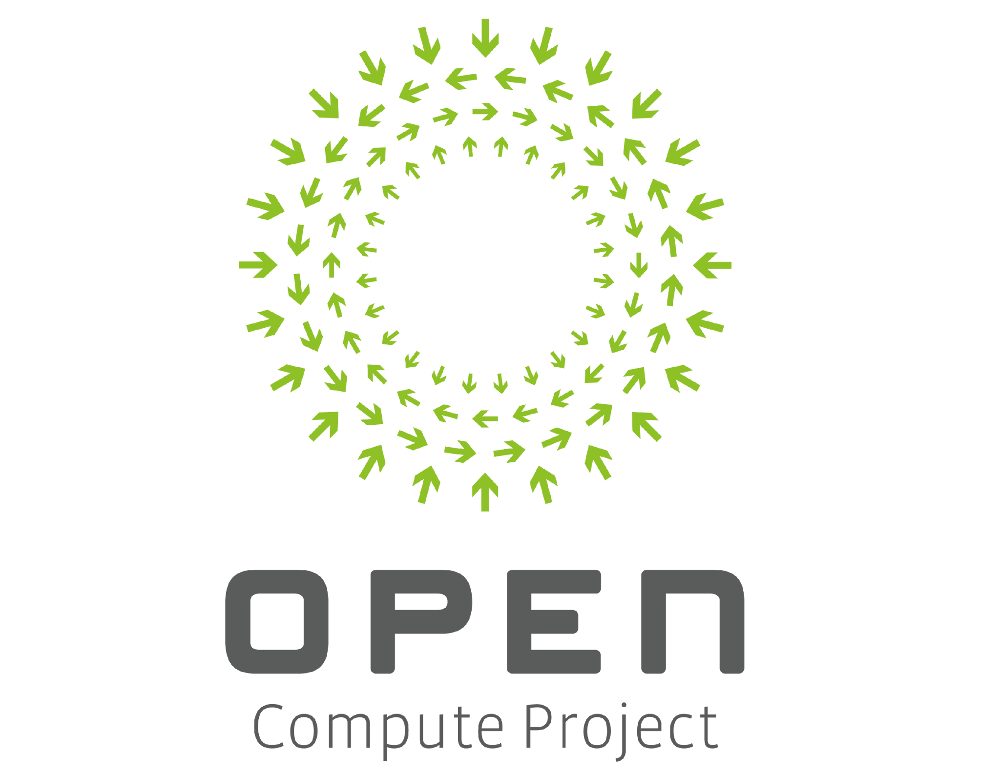

Open Platform Firmware

Open Silicon Firmware Interface (openSFI)

Firmware Architecture Specification (FAS)

Version 0.3

Authors:

Raj Kapoor (AMD), Albert Rennie (AMD), Srini Narayana (AMI), Tim Lewis
(Insyde)

Collaborators:

Allison Goodman (Intel), Michael Kinney (Intel), Felix Polyodov (AMI),
Giri Mudusuru (Microsoft), Ian Goegebuer (Google), Paul Grimes (AMD),
Pradeep Gopal (AMD), Christian Walter (9 Elements), Senthil
Ramakrishnan (ARM), Jose Marinho (ARM), Jean-Marie Verdun (HPE), Nil
Ge (ByteDance), Hancock Chang (MiTAC), Piotr Król (3mdeb), Amos Bu
(OSFF)

# Version History

| **Date** | **Version \#** | **Author** | **Description** |
|----|----|----|----|
| 27 MAY ‘25 | 0.0.1 | Paul Grimes | Initial Release |
| 02 JUN ‘25 | 0.3 DRAFT | Albert Rennie Raj Kapoor | \- Added Technical details throughout the document. Ready for OPF review. - Added [Chapter 10 - Abstraction Layer](chapters/appendix-e-abstraction-layer.md#appendix-e---abstraction-layer-defined-interface-spec) - Added [Chapter 11 - Platform Configuration](chapters/platform-input-configuration-semantics.md#10-platform-input-configuration-semantics) - Overhauled [Chapter 11 - Platform Input Configuration Semantics](chapters/platform-input-configuration-semantics.md#10-platform-input-configuration-semantics) - Added [Appendix B - Clarifying Notes](chapters/appendix-b-clarifying-notes.md#appendix-b---clarifying-notes) - Added [Appendix C - Unified Enumerated Stages List](chapters/appendix-c-unified-enumerated-stages-list.md#appendix-c---unified-enumerated-stages-list) - [License](#license) changed back to CC BY 4.0 per discussion in Mar 2025 F2F - Added clarifying notes for SOCID & ExecuteSiliconRuntimeOp() at the bottom of [Section 8.2](chapters/api-definition.md#82-executesiliconruntimeop) - Added Clarifying Notes for VAL in the [Terminology Section](chapters/terminology.md#3-terminology) |
| 23 SEP’25 | 0.3 | Albert Rennie Raj Kapoor | Voting Roster for OPF Ratification - COMPLETE Ready for OCP Steering Committee WG Review • This document will be frozen, and v0.5 DRAFT will be started based on this version. • **OCP SC Approved - 09 SEP’25 (v0.3 FROZEN)** |

# License

openSFI Firmware Architecture Specification is licensed under [**CC BY
4.0**](https://creativecommons.org/licenses/by/4.0/). To
view a copy of this license, visit
<https://creativecommons.org/licenses/by/4.0/>

**Creative Commons**

OCP encourages participants to share their proposals, specifications and
designs with the community. This is to promote openness and encourage
continuous and open feedback. It is important to remember that by
providing feedback for any such documents, whether in written or verbal
form, that the contributor or the contributor's organization grants OCP
and its members irrevocable right to use this feedback for any purpose
without any further obligation.

It is acknowledged that any such documentation and any ancillary
materials that are provided to OCP in connection with this document,
including without limitation any white papers, articles, photographs,
studies, diagrams, contact information (together, “Materials”) are made
available under the Creative Commons Attribution 4.0 International
License found here:
<https://creativecommons.org/licenses/by/4.0/>,
or any later version, and without limiting the foregoing, OCP may make
the Materials available under such terms.

As a contributor to this document, all members represent that they have
the authority to grant the rights and licenses herein. They further
represent and warrant that the Materials do not and will not violate the
copyrights or misappropriate the trade secret rights of any third party,
including without limitation rights in intellectual property. The
contributor(s) also represent that, to the extent the Materials include
materials protected by copyright or trade secret rights that are owned
or created by any third-party, they have obtained permission for its use
consistent with the foregoing. They will provide OCP evidence of such
permission upon OCP’s request. This document and any "Materials" are
published on the respective project's wiki page and are open to the
public in accordance with OCP's Bylaws and IP Policy. This can be found
at
<http://www.opencompute.org/participate/legal-documents/>
. If you have any questions, please contact OCP.

# 1. Acknowledgements

The Authors of this Specification would like to acknowledge the
following for their feedback:

3mdeb, 9elements, AMD, AMI, ByteDance, Google, Hewlett Packard
Enterprise (HPE), Intel,

Insyde, Microsoft, MiTAC

# 2. Compliance with OCP Tenets

## 2.1. Openness

Promotes openness and efficiency by enabling third parties to build,
modify, and personalize a unified firmware interface that is compatible
across multiple platforms and silicon architectures.

## 2.2. Efficiency

Reduce operational expenses, capital expenses and carbon emissions
through a unified firmware interface. This enables efficient resource
utilization, streamlines development processes, and eliminates redundant
engineering efforts.

## 2.3. Impact

Has transformative impacts on the industry by accelerating
time-to-market with standardized interfaces.

## 2.4. Sustainability

Enables optimization of code to reduce resource consumption.

# 3. Terminology

[Read this chapter →](chapters/terminology.md)

# 4. Scope

[Read this chapter →](chapters/scope.md)

# 5. Problem Statement

[Read this chapter →](chapters/problem-statement.md)

# 6. Introduction

[Read this chapter →](chapters/introduction.md)

# 7. Architecture Overview

[Read this chapter →](chapters/architecture-overview.md)

# 8. API Definition

[Read this chapter →](chapters/api-definition.md)

# 9. Initialization Stages

[Read this chapter →](chapters/initialization-stages.md)

# 10. Platform Input Configuration Semantics

[Read this chapter →](chapters/platform-input-configuration-semantics.md)

# 11. Standards Alignment

[Read this chapter →](chapters/standards-alignment.md)

# 12. Governance

[Read this chapter →](chapters/governance.md)

# Appendix A PascalCase Naming Convention (with Capitalized Acronyms)

[Read this chapter →](chapters/appendix-a-pascalcase-naming-convention.md)

# Appendix B - Clarifying Notes

[Read this chapter →](chapters/appendix-b-clarifying-notes.md)

# Appendix C - Unified Enumerated Stages List

[Read this chapter →](chapters/appendix-c-unified-enumerated-stages-list.md)

# Appendix D - Supporting Documentation & Guidance

[Read this chapter →](chapters/appendix-d-supporting-documentation.md)

# Appendix E - Abstraction Layer (Defined Interface Spec)

[Read this chapter →](chapters/appendix-e-abstraction-layer.md)

# Appendix F

[Read this chapter →](chapters/appendix-f-sc-approval-checklist.md)
