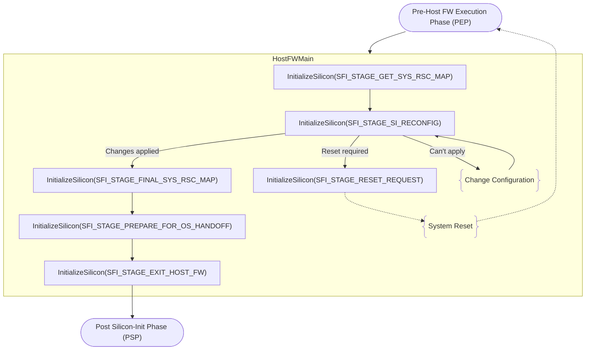

# InitializeSilicon: Per Stage Input/Output Argument Definitions

## Table of Contents

- [Scope](#scope)
- [Control Flow](#control-flow)
- [PEP](#pep)
- [SFI_STAGE_GET_SYS_RSC_MAP](#sfi_stage_get_sys_rsc_map)
- [SFI_STAGE_SI_RECONFIG](#sfi_stage_si_reconfig)
- [SFI_STAGE_RESET_REQUEST](#sfi_stage_reset_request)
- [SFI_STAGE_FINAL_SYS_RSC_MAP](#sfi_stage_final_sys_rsc_map)
- [SFI_STAGE_PREPARE_FOR_OS_HANDOFF](#sfi_stage_prepare_for_os_handoff)
- [SFI_STAGE_EXIT_HOST_FW](#sfi_stage_exit_host_fw)

## Scope

The OpenSFI interface is built around the `InitializeSilicon()` function.

```c
SFIStatus InitializeSilicon (
  void *SFIInput, void *SFIOutput, uint32_t 	InitStageID
);
```

Host Firmware initializes silicon by repeatedly calling `InitializeSilicon` with different `InitStageID` values.

`SFIInput` and `SFIOutput` parameters of `InitializeSilicon()` are pointers to a [Firmware Handoff Transfer List (FHTL)](https://firmwarehandoff.github.io/firmware_handoff/main/transfer_list.html).

[Firmware Handoff Transfer List (FHTL)](https://firmwarehandoff.github.io/firmware_handoff/main/transfer_list.html) is a collection of [Transfer Entries (TE)](https://firmwarehandoff.github.io/firmware_handoff/main/transfer_list.html#tl-entry-header). 

*The scope of this document is to define structure of the `SFIInput` and `SFIOutput` transfer lists for each initialization stage (for each `InitStageID` value).*

The document expresses `SFIInput` and `SFIOutput` content in terms of the following entry types:

- [`XFERLIST_ACPI_AGGR`](https://firmwarehandoff.github.io/firmware_handoff/main/transfer_list.html#acpi-table-aggregate-entry-layout-xferlist-acpi-aggr) — a sequence of complete ACPI tables
- `XFERLIST_SMBIOS_AGGR` — a sequence of complete SMBIOS structures (*proposed for addition to the Firmware Handoff Specification*)
- `XFERLIST_UPCI_AGGR` — a sequence of UPCI records (*proposed for addition to the Firmware Handoff Specification*). Each UPCI record starts with the UPCI record header containing record type and length. The specific format of the header is outside the scope of this document.

The interface is **data-only**: no entry or record contains a callback, function pointer, or other executable reference.

Each entry is a *compound* entry: it aggregates multiple elements of one kind.

## Control Flow



## PEP

### Input

This section lists host FW configuration that needs to be accessible during PEP execution

#### Previous Platform Configuration

**Required:** when platform reset occurred as a result of the `InitializeSilicon(SFI_STAGE_RESET_REQUEST)` call.

**Conditional:** to support faster boot time

#### Memory Configuration

##### DIMM SPD Data

Host FW needs to make SPD data available either indirectly, by describing SPD access mechanism, or directly, by exposing SPD image. The following sample data structures can be used.

###### DIMM SPD Access

Enables the silicon to read each DIMM's SPD over a management (sideband) bus. This record is required when the platform exposes DIMM SPD over a sideband bus and no SPD Data record is supplied for the same devices.

```c
typedef struct {
    // index the silicon resolves to its own on-SoC sideband controller
    uint8_t  LogicalBusID;
    // SFIDIMMSPDBusType: sideband bus family used to reach the SPD
    uint8_t  BusType;
    uint8_t  Channel;        // memory channel the DIMM is attached to
    uint8_t  Slot;           // DIMM slot identifier within the channel
    uint16_t TargetAddress;  // bus-specific device address
    uint8_t  Reserved[2];    // MUST be zero
} SFIDIMMSPDAccessEntry;

typedef struct {
    UPCIRecord            Record;
    uint32_t              EntryCount;  // number of elements in Entries[]
    uint32_t              Reserved;    // MUST be zero
    // EntryCount elements, one per DIMM
    SFIDIMMSPDAccessEntry Entries[];
} SFIDIMMSPDAccess;

// SFIDIMMSPDBusType — sideband bus used for SPD access
typedef enum {
    BUS_TYPE_SMBUS = 0,
    BUS_TYPE_I2C   = 1,
    BUS_TYPE_I3C   = 2
} SFIDIMMSPDBusType;
```

`LogicalBusID` is an opaque index whose specific values are defined by the silicon (SoC) specification. The board populates each DIMM entry with the value that identifies the bus its SPD is wired to, and the silicon resolves that value to the corresponding physical controller. This lets a platform with several sideband buses direct each SPD access to the correct one without exposing any SoC-internal addressing.

The record intentionally does not describe how to reach the controller; it is defined on the assumption that the silicon already knows how to access its own sideband controllers.

###### SPD Data

Carries a verbatim JEDEC SPD image for a memory device. The record is required for SPD-less platforms.

```c
typedef struct {
    UPCIRecord Record;
    uint8_t    Channel;      // memory channel the device is attached to
    uint8_t    Slot;         // DIMM slot identifier within the channel
    // verbatim JEDEC SPD image (opaque); length from record length
    uint8_t    SPDBytes[];
} SFISPDData;
```

The image length is recoverable from the record length (and also from the SPD's own size byte). The record intentionally carries no separate fields for the DDR generation or SPD revision; the silicon reads these directly from the SPD image contents (JEDEC key/type, revision, and size bytes).

Each `SFISPDData` record describes a single device, identified by its `Channel` and `Slot`. A platform with multiple DIMMs supplies one `SFISPDData` record per device; the records appear as separate UPCI records within `XFERLIST_UPCI_AGGR`, and the silicon collects them by walking the record sequence

##### Memory Configuration Policy

Conditional host-selected policy, honored only where the platform is capable. When the record or a field is absent, the silicon applies its default.

```c
typedef struct {
    UPCIRecord Record;
    // SFITrainingHint: how the silicon should approach DRAM training
    uint8_t    TrainingHint;
    // SFIECCPolicy: requested ECC behavior where supported
    uint8_t    ECCPolicy;
    uint8_t    Reserved[6];  // MUST be zero
} SFIMemConfigPolicy;

// SFITrainingHint
typedef enum {
    // silicon default
    TRAINING_HINT_DEFAULT = 0,
    // force full training; ignore any saved data
    TRAINING_HINT_FULL = 1,
    // prefer the faster training mode if several exist
    TRAINING_HINT_FAST = 2,
    // restore from the supplied Training Data record
    TRAINING_HINT_USE_SAVED_TRAINING = 3,
    // Memory Overwrite Request
    TRAINING_HINT_MOR = 4
} SFITrainingHint;

// SFIECCPolicy
typedef enum {
    ECC_POLICY_DEFAULT = 0,
    ECC_POLICY_ENABLE  = 1,
    ECC_POLICY_DISABLE = 2,
} SFIECCPolicy;
```

##### DIMM Training Data

The Training Data record is a standard record type whose payload is an opaque, silicon-defined blob. Because the record type is standardized, host firmware can identify, persist, and round-trip it without vendor-specific knowledge; the payload remains vendor-opaque.

```c
typedef struct {
    UPCIRecord Record;  // UPCI record header
    // opaque silicon-defined calibration data; length from record length
    uint8_t    CalibrationBlob[];
} SFITrainingData;
```

On input, as PEP platform information, this record is required when `TrainingHint = TRAINING_HINT_USE_SAVED_TRAINING`. Its presence permits the silicon to skip training after validating the blob. The silicon must fall back to full training when the blob is absent, invalid, or when `TrainingHint` is `TRAINING_HINT_FULL`.

### Output (HostFWMain Input)

#### Initial Memory Map

#### DIMM Training Data

## SFI_STAGE_GET_SYS_RSC_MAP

### Platform state

- Memory is available
- SoC is minimally configured to enable PCI bus enumeration by the host FW

### Input

None

### Output

#### System Address Map

```c
typedef struct {
    uint64_t BaseAddress;    // physical base of the region
    uint64_t Size;           // size of the region in bytes
    uint32_t Attributes;     // properties of the address range
    uint32_t Class;          // defines how the range is used;
                             // MUST be 0 for non-reserved ranges
} SFIAddressMapEntry;

typedef struct {
    UPCIRecord Record;
    uint32_t   EntryCount;  // number of elements in Entries[]
    uint32_t   Reserved;    // MUST be zero
    // EntryCount elements, one per region
    SFIAddressMapEntry Entries[];
} SFISystemAddressMap;

// SFIAddrassRangeAttr — 32-bit region attribute bitmask
typedef enum {
    // region is present but reserved by the silicon FW;
    // not for general OS/firmware use
    ATTR_RESERVED    = 1u << 0,
    // MMIO region
    ATTR_MMIO      = 1u << 1,
} SFIAddrassRangeAttr;

// Resource Classes: TBD
```
#### System I/O Map

TBD

#### Root Bridge Configuration

```c
typedef struct {
    uint16_t RootBridgeId;    // Root bridge ID
    uint16_t Segment;         // PCI segment group number
    uint8_t  StartBus;        // first bus decoded by the bridge
    uint8_t  EndBus;          // last bus decoded by the bridge
    uint16_t Flags;           // SFIRootBridgeFlags
    uint64_t ConfigSpace;     // Host address of the PCI-E configuration space
} SFIRootBridgeEntry;

// Root Brdige Flags
// TBD

typedef struct {
    UPCIRecord Record;
    uint32_t   EntryCount;  // number of elements in Entries[]
    uint32_t   Reserved;    // MUST be zero
    // EntryCount elements, one per region
    SFIRootBridgeEntry Entries[];
} SFIRootBridgeConfiguration;
```

PCI Root Bridge Configuration is not expressed by means of ACPI MCFG Table because the latter lacks root bridge ID, which is required to identify specific root bridge instance during the `SFI_STAGE_SI_RECONFIG` stage.

#### SMBIOS

| SMBIOS Type | Structure |
|-------------|-----------|
| Type 16 | Physical Memory Array |
| Type 17 | Memory Device |
| Type 19 | Memory Array Mapped Address |

#### ACPI

| ACPI Table | Present when |
|------------|--------------|
| SRAT | the SoC supports NUMA |
| SLIT | the SoC supports NUMA |
| PMTT | the platform has persistent memory (NVDIMM) or a multi-controller / multi-level memory topology |
| HMAT | heterogeneous or tiered memory is present |
| CEDT | the SoC supports CXL |

## SFI_STAGE_SI_RECONFIG

### Input

#### Root Bridge Resource Map

Root Bridge Resource Map is a collection of UPCI record (one per root bridge) defining proposed resource configuration for each root bridge described by the `SFIRootBridgeConfiguration`.

```c
typedef struct {
    UPCIRecord Record;
    uint16_t RootBridgeId;    // Root bridge ID
    // ACPI Resource Descriptor
} SFIRootBridgeResourceMap;
```

### Output

The output depends on the status returned by the `InitializeSilicon`

#### Success / Reset Required

None

#### Error (Configuration Cannot be Applied)

SFIRootBridgeResourceMap updated with the proposed resources.

***Note:*** Silicon FW returns root bridge configuration without applying it. Host FW must explicitly call `SFI_STAGE_SI_RECONFIG` to apply the proposed configuration.

## SFI_STAGE_RESET_REQUEST

### Input

None

### Output

None

## SFI_STAGE_FINAL_SYS_RSC_MAP

### Input

### Output

## SFI_STAGE_PREPARE_FOR_OS_HANDOFF

### Input

### Output

## SFI_STAGE_EXIT_HOST_FW

### Input

### Output

